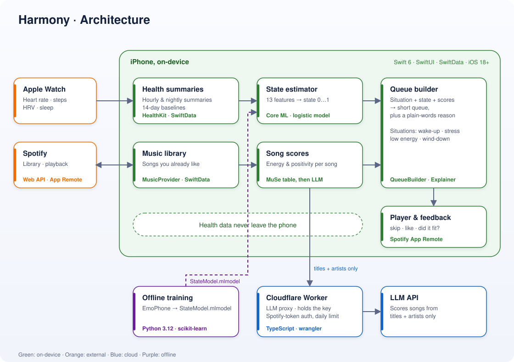

# Context-Aware Music Companion — CSE 406 Group G02 "FireStarter"

iPhone app that picks songs from the user's own Spotify library for four moments
(wake-up, stress, low energy, wind-down), using smartwatch data (heart rate, steps,
sleep) compared with the person's own usual values.

Repository: https://github.com/SkaosDev/Harmony

Documentation (course report): [`docs/main.pdf`](https://github.com/SkaosDev/Harmony/blob/main/docs/main.pdf) · [`docs/main.tex`](https://github.com/SkaosDev/Harmony/blob/main/docs/main.tex)

Members: Clément Royer, Cyprien Vanden Abeele, Lucas Miskulin, Riad Mekideche.

## Architecture

Everything runs on the iPhone. The only cloud piece is a Cloudflare Worker that holds the LLM key.
Details: `docs/PROJECT.md` §4.

<p align="center">
  
</p>

### Where things run

| Where | What | Data it sees |
|---|---|---|
| iPhone | the whole app, the Core ML model, storage | health data, library, feedback (never sent elsewhere) |
| Cloudflare Worker | LLM proxy: keeps the key, checks the user, rate-limits | song titles and artists only |
| Spotify | sign-in, library, playback | what Spotify already has |
| Offline (Python) | training, evaluation, MuSe table build | EmoPhone (local, never on Git) |

### App modules

The core (`SongScorer`, `FeatureBuilder`, `StateEstimator`, `QueueBuilder`) only knows the two
protocols `MusicProvider` and `HealthProvider`, never Spotify or HealthKit directly. Each has a
real implementation and a **demo** one (synthetic data), so the app runs entirely on the simulator.

| Module | Role | Status |
|---|---|---|
| `MusicProvider` + Spotify / Demo | sign-in (PKCE), library import, lookup, playback, save | sign-in, import, demo done; playback to do |
| `HealthProvider` + HealthKit / Demo | consents, anchored reads of heart rate, steps, HRV, sleep | done |
| `SummaryStore` / `BaselineCalculator` | hourly and nightly summaries, 14-day personal baselines | summaries done; baselines to do |
| `SongScorer` | energy / positivity per song: MuSe, then LLM via the Worker, cached | done (run from the Debug screen) |
| `FeatureBuilder` + `StateEstimator` | the 13 features of `PROJECT.md` §6, Core ML inference | model and fixtures ready; Swift to do |
| `SituationSuggester` | which of the 4 situations to highlight | to do |
| `QueueBuilder` + `Explainer` | short queue from the library and its plain-words reason | to do |
| `PlayerController` + `FeedbackStore` | playback, skip / like / "did it fit?" | to do |
| `DataControl` | see, export, delete all data | to do |
| Worker (`worker/`) | `POST /score`, Spotify-token auth, daily limit | done, deployed (Claude Haiku 5.5) |

### Data flow in one sentence

Watch data are reduced to hourly and nightly summaries (raw samples are dropped), compared with
the person's own last 14 days, turned into 13 features, and fed to a small logistic model
(Core ML) that gives a 0–1 "state"; with the chosen situation, it selects a short queue of songs
the user already likes, scored by energy and positivity. There is no medical claim and no emotion
is named to the user.

### Python ↔ Swift contract

`ml/features.py` is the single source of truth for the features. The model is exported with
`ml/export.py` (`model_params.json`, `StateModel.mlmodel`) and 10 synthetic golden cases
(`ml/fixtures/state_cases.json`) let the Swift tests check the same values to 1e-6. Changing a
feature means retraining and regenerating these files.

### Tech stack

Swift 6, SwiftUI, SwiftData, HealthKit, Core ML (iOS 18+, Xcode 27.2) · Spotify Web API + iOS SDK
App Remote · Python 3.12, pandas, scikit-learn 1.5.2, coremltools 8 · Cloudflare Worker (TypeScript).

## Start here

1. `docs/PROJECT.md` — full context: idea, decisions, architecture, data, model, where we are.
2. `docs/TODO.md` — ordered checklist, from setup to the final report.
3. `CLAUDE.md` — rules for Claude Code (general guidelines + project rules).
4. `docs/superpowers/specs/2026-11-23-modele-etat-v2-design.md` — state model v2 (decided, not yet
   built): one-tap questions that tune the model to each user on the iPhone; TODO Phase 6.
   Evidence: `docs/research/2026-11-23-modele-etat-v2/`.

## Repository layout

| Folder | Content |
|---|---|
| `docs/` | LaTeX sources of the documents (IEEE template). `main.tex` holds Submission A (revised) and Submission B; `Submission-B.md` is a Markdown version. `submission-A.pdf` is the version handed in for A. |
| `docs/design/` | The app's screens (copy of the design canvas): to reproduce exactly, see its `README.md` |
| `app/` | iPhone app (Swift, SwiftUI) — from the implementation phase |
| `ml/` | Python code for the song scores and the state model (`explore_d1.py` reproduces Table VII of Submission B) |
| `data/` | **Local only, never committed** (see below) |

## Prerequisites

What you need depends on the part you work on. Each line comes with a command to check it.

### Everyone

| What | Check |
|---|---|
| Git, and the collaborator invitation to `SkaosDev/Harmony` accepted | `git clone https://github.com/SkaosDev/Harmony.git` |
| Claude Code | `claude --version` |
| GitHub CLI, to open and review PRs (optional) | `gh auth status` |

### iPhone app (Mac only)

iOS apps can only be built on a Mac.

| What | Check |
|---|---|
| Xcode 27.2 + command-line tools (`xcode-select --install`) | `xcodebuild -version` |
| Node.js 18+ (for XcodeBuildMCP now, and for `wrangler`, the Cloudflare Worker tool, later) | `node -v` |
| XcodeBuildMCP in Claude Code: `claude mcp add -s user XcodeBuildMCP -- npx -y xcodebuildmcp@latest mcp` | `/mcp` in Claude Code lists it as connected |

Before the first build, copy `app/Harmony/Config.example.xcconfig` to `app/Harmony/Config.xcconfig`
and fill it in (see `app/README.md`); this file is ignored by Git.

The simulator needs nothing more. To run the app on a real iPhone you also need:
- your iPhone registered in the team's Apple Developer account (HealthKit does not work with a free account);
- the Spotify app, logged in with an account added to the team's Spotify developer dashboard
  (5 users max); playback needs Spotify Premium;
- an Apple Watch for real health data (otherwise use the demo mode, TODO 1.17).

### ML scripts (Windows or Mac)

| What | Check |
|---|---|
| Python 3.12 (not 3.14: the pinned scikit-learn 1.5.2 does not install on it) | `python --version` |
| Virtual environment + dependencies (commands below) | `python -c "import sklearn; print(sklearn.__version__)"` prints `1.5.2` |
| EmoPhone waves copied to `data/emophone/D1`, `D2`, `D3` (ask the team; never commit them) | `git status` does not list them |
| UC Irvine copied to `data/uci/` (optional, ideally before Phase 4: TODO 5.1) | `git status` does not list it |

```sh
# Windows (PowerShell). If activation is blocked:
#   Set-ExecutionPolicy -Scope CurrentUser RemoteSigned
py -3.12 -m venv .venv
.venv\Scripts\activate

# macOS
python3.12 -m venv .venv && source .venv/bin/activate

# Both
pip install -r ml/requirements.txt
python ml/explore_d1.py --data data/emophone/D1   # must reproduce Table VII of the report
```

### Report

A LaTeX distribution with `latexmk`: MacTeX on Mac, MiKTeX or TeX Live on Windows. Check: `latexmk -v`.

## Build the documents

```sh
cd docs
latexmk -pdf main.tex
```

`IEEEtran.cls` (v1.8b) is included so the document builds without extra packages.

## Datasets and terms of use

- **EmoPhone** (Harvard Dataverse, doi:10.7910/DVN/QGRVU8): access granted by the
  dataset authors for this project. The data files must not be redistributed, so they
  stay in `data/` on team computers and are ignored by Git.
- **UC Irvine** (Dryad, doi:10.7280/D1WH6T): same rule, kept in `data/`.
- **MuSe** (Akiki & Burghardt 2021, doi:10.5334/johd.33, v3 on Kaggle, CC BY 4.0): may be
  redistributed with credit; the reduced table used by the app is versioned in
  `app/Harmony/Resources/muse.sqlite` (built by `ml/muse_build.py`).

Before each submission, check that `git ls-files data/` lists nothing but `data/README.md`.
