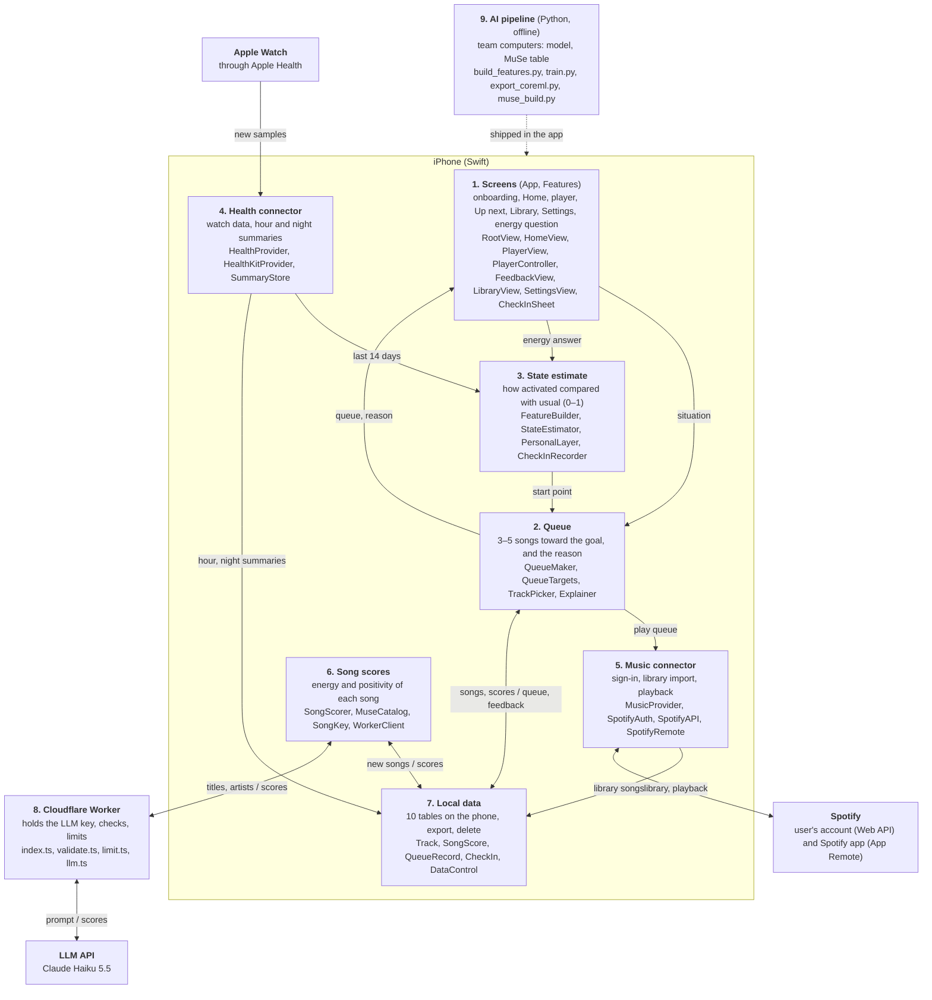
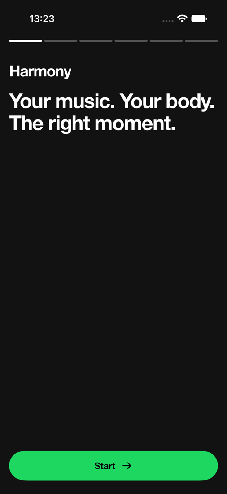
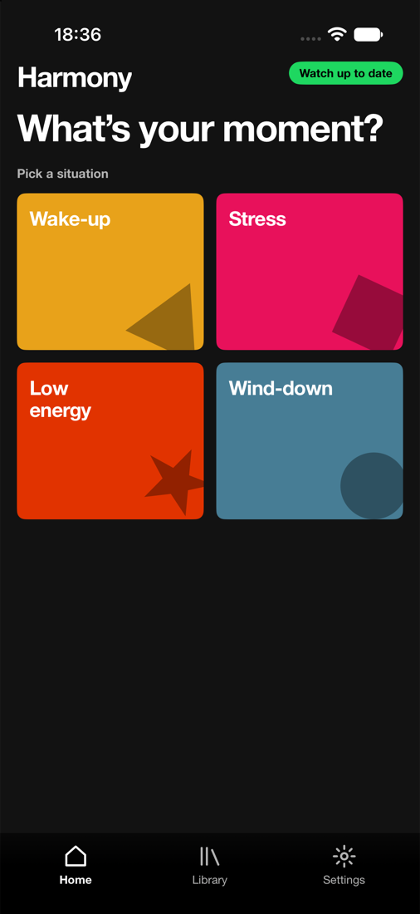
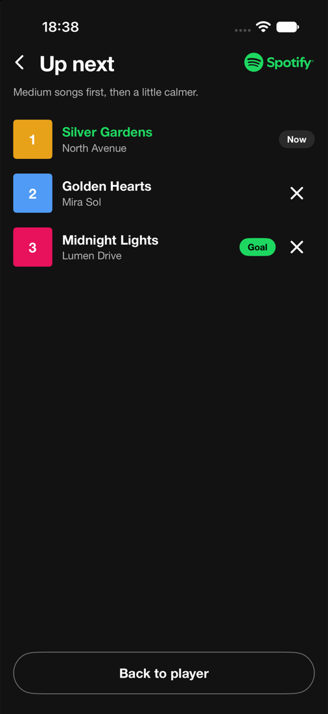
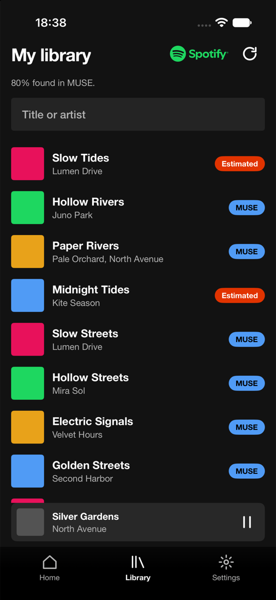

# Context-Aware Music Companion Using Wearable Health Data

*Choosing the right song, from your own Spotify library, for the moment you are in*

**ROYER, Clément** · **VANDEN ABEELE, Cyprien** · **MISKULIN, Lucas** · **MEKIDECHE, Riad**
Dept. Computer Science, Hanyang University, Seoul, S. Korea

Group G02 "FireStarter" — Repository: <https://github.com/SkaosDev/Harmony>

*Submissions C and D, handed in together: architecture design, implementation, use cases. Sections I–IV revise Submissions A and B; Sections V–VII are new. Markdown version of `Submission-C.pdf` (Nov. 26, 2026).*

**Abstract —** Waking up, stress, an afternoon energy dip and falling asleep are moments in which the right music can help, but nobody wants to search for it at that moment. We built an **iPhone app** that picks songs from the user’s own **Spotify** library to fit the moment. Each saved song gets two simple scores (how calm or energetic it is, and how positive it sounds) from the public **MuSe** dataset or, when missing, from a **language model**. From the **Apple Watch** heart rate, steps and sleep, and the time of day, a small model estimates whether the person is more or less activated than usual; an optional one-tap question, “energy right now?”, lets the app learn over time what is usual for this person. Simple rules then play a short queue that starts close to the person’s current state and moves step by step toward a calmer or more energetic state. The model is trained on **EmoPhone**, a dataset of 282 students in Korea who wore a watch and reported their mood several times a day; its results are modest but real, and we report them honestly. The app is built and tested, and a one-week pilot with a real user is under way. The tech stack is as follows: **Swift** and **SwiftUI** for the app, **HealthKit** for watch data, the **Spotify Web API** and **iOS SDK** for the library and playback, **Python** and **scikit-learn** for training, and **Core ML** to run the model on the phone, so that health data never leave it.

**Index Terms —** music recommendation, wearable data, context-aware app, Spotify, iOS, Core ML

## Role Assignments

Table I gives the roles. The group has no leader: every member develops, every pull request is reviewed by another member, and decisions are taken together at a weekly meeting. Building an iPhone app requires a Mac, and Clément is the only member who owns one, so Clément writes the app in Swift while the other members work on the AI model and on the design of the app.

**Table I — Role Assignments**

| **Role** | **Name** | **Task description** |
|---|---|---|
| User | Clément | Uses the app every day with a Spotify account and an Apple Watch during the one-week pilot; reports bugs. The other members try the app in demo mode. |
| Customer | Cyprien | Checks that each feature answers the needs of Section I-B; reviews every text of the app and the screen designs; approves demos; decides trade-offs such as privacy versus accuracy. |
| Software developer | Clément | Builds the iPhone app in Swift: Spotify, Apple Health, state estimate on the phone, queue, screens and tests; maintains the repository and the documents. |
| Software developer | Cyprien | Builds the AI model: datasets, song-score table, training and evaluation of the state model. |
| Software developers | Lucas, Riad | Work on parts of the AI model and design the screens of the app. |

## I. Introduction

### A. Motivation

Poor sleep and stress are an everyday problem in Korea. A report based on a KB Financial Group study gives an average sleep time of 471 minutes per day, 30 minutes below the OECD average, and cites a Philips survey in which only 41% of Koreans were satisfied with their sleep, with stress as the first cause of disturbed sleep [1].

Music can help: a Cochrane review of 13 randomised trials (1,007 adults) found that listening to music improved sleep quality by 2.79 points on the Pittsburgh Sleep Quality Index, with moderate certainty of evidence [2]. This is evidence about music in general; it does not show that our app will improve well-being, and our pilot will not test that.

Music streaming is part of daily life, yet streaming platforms still ignore the body of the listener. Our first users are students and young workers who listen to music on their phone, wear a smartwatch and have irregular schedules. They want the music they already like, at the right moment, with one tap. The team members belong to this group and act as users during development.

### B. Problem Statement (User Needs)

Given the time of day and the recent signals of the person’s body compared with their own usual values, which songs from their own library should be played, and in which order, to help them through the moment? Table II lists the four situations we address.

**Table II — Target Situations**

| **Situation** | **Typical moment** | **Goal of the music** |
|---|---|---|
| Wake-up | Morning, after sleep | Gently more energetic |
| Stress | Any time of day | Calmer |
| Low energy | Afternoon slump | More energetic |
| Wind-down | Evening, night | Calm and sleepy |

- **N1. No effort:** a tired or stressed person does not want to search for a playlist; one tap should start suitable music.
- **N2. My own music:** songs come mainly from the user’s library, never from generated audio.
- **N3. Fit to my body and my day:** listening history and time of day alone ignore how the person is doing physically.
- **N4. Control of my data:** heart rate and sleep are sensitive; the user must know what is read and be able to delete it.

### C. Existing Solutions

Table III compares the closest products we found, from their public pages; we did not install or test them.

**Table III — Comparison With Related Software**

| **Solution** | **Body signals?** | **User’s own songs?** | **Notes** |
|---|---|---|---|
| Endel [3] | Yes: heart rate, time, weather | No: generates its own sounds | Paid; iOS, Android, Watch |
| Spotify daylist [4] | No: habits and time of day | Yes, through history | Updated several times a day |
| Spotify Prompted Playlists [5] | No: typed prompt and history | Yes, through history | Premium, US and Canada, beta |
| **Our app** | **Yes: heart rate, steps, sleep, time** | **Yes: saved library first** | **iPhone and Spotify first** |

**Endel** reacts to the body but creates its own audio, and its claims about effects are company claims [3]. **Spotify** personalises from history and context, but the articles on daylist and Prompted Playlists mention no wearable [4], [5]. A systematic review of context-aware music recommenders (100 papers) finds that body signals are little studied, partly because suitable datasets are lacking [6]. We found no product that combines body signals and the user’s own library; this rests on a limited search, so our argument is the added value of body signals and of a clear goal, not better accuracy than Spotify.

### D. Proposed Solution

Fig. 1 shows the app in three parts. The person can always choose the situation with one tap and skip any song.

*Fig. 1. System overview (diagram in the PDF): Spotify account → 1. Song scores; Apple Watch and time → 2. State estimate; both → 3. Song choice (rules) → Playback in Spotify, with skip and like feedback back to the rules.*

**Song scores.** Spotify removed its audio features (valence, energy) for new apps in November 2024 [7], so the app cannot analyse the sound. We use **MuSe**, a public dataset of 90,408 songs with valence and arousal scores built from Last.fm tags, with tentative Spotify IDs for about 68% of them [8]. For songs not in MuSe, a large language model (LLM) estimates the two scores from the title and artist; this estimate is checked on songs present in MuSe.

**State estimate.** A small model says whether the person is currently more or less activated than usual, never a named emotion. Asking each user for weeks of personal data would make a poor first day, so we train on **EmoPhone** [9]: three yearly waves (2020–2022) of university students in Korea who wore a Fitbit and answered short mood questions about seven times a day for four weeks (297 participant records from 282 people after quality control). Its *arousal* answer, turned into “above or below this person’s own average”, is exactly our output. The model uses four inputs: the time of day, the heart rate, the steps and last night’s sleep, each compared with the person’s own average over the last 7 to 14 days, which needs no training on the user. A night or a period when the watch was not worn is marked as unknown, never as zero sleep or zero steps. The dataset authors granted us access for this project; the data files stay on team computers (NFR9).

**Learning the person’s usual.** People differ, and a model trained on other people cannot know them. If the user agrees, the app therefore asks at most twice a day one optional question, “energy right now?” (Low, Medium or High), answered with one tap from the notification. The answers stay on the phone and slowly adjust the estimate to this person (FR15).

**Song choice.** Rules build a queue of 3 to 5 songs: the first one or two match the current state, the next ones move step by step toward the goal of the situation. This follows the **iso principle** of music therapy, supported by a controlled experiment on mood after a sad film clip [10]. If the library has too few suitable songs, at most two MuSe songs close to the user’s taste complete the queue and are marked as new.

**An example.** At 11:30 p.m. the user taps Wind-down. The heart rate is above the person’s usual evening value, so the first two songs have a medium energy and the next ones become calmer step by step. A skip is recorded for future queues.

**How we test it.** (1) Song scores: correlation between the LLM estimate and MuSe on shared songs. (2) State estimate: tests on people the model has not seen, never a random split of one person’s data, then on a whole held-out wave, compared with a time-of-day baseline; if the model does not beat the baseline, it is not used. (3) Pilot: one participant, a team member (Spotify’s development mode allows at most five accounts [11]), for one week, with the watch data used every day; we measure skip rates, a one-tap “did it fit?” answer and whether the optional questions help the estimate for this person. The pilot measures fit, not health benefits.

**Limits.** The app is a demonstrator for five users and a wellness companion, not a medical tool. The training data come from a Fitbit and Android phones, not from an Apple Watch, so the pilot measures the remaining gap. Accuracy is modest (Section VII); the one-tap situation choice keeps the app useful when the estimate is wrong.

**Going further.** All music access goes through one small interface and all health data through another, so supporting Apple Music, Deezer or a watch on Android means writing one new connector (Section IV-G).

### E. Development Plan and Status

Each milestone ends with a demo to the customer. The plan of Submission A put M1 at the end of October; the dates below replace it.

- **M1, Nov. 15:** Spotify sign-in and import tested with a live account, reading of Apple Health data, demo mode.
- **M2:** song scores; state model trained on EmoPhone and tested on held-out people and a held-out wave.
- **M3:** queue building, playback, feedback, explanation and data-control screens.
- **M4, Nov. 26 to Dec. 4 (end of the project):** pilot (one week, Nov. 26 to Dec. 2), evaluation, final report and demo.

**Status on Nov. 26, 2026.** The features of M1 to M3 are built and tested (Section V); the optional questions were added just before the pilot, which started on Nov. 26. All code goes through pull requests on GitHub, reviewed by another member; the team meets weekly and decides together.

**Changes since Submission A.** EmoPhone replaces UC Irvine and PMData as training data (larger, in-the-moment labels, Korean students). The model inputs are now the time of day, the heart rate, the steps and last night’s sleep. Heart-rate variability is no longer a model input, because EmoPhone does not contain it; it is still read for the explanation. EmoPhone has no watch-measured sleep either, so for training we estimate it from the Fitbit heart rate and steps (Section IV-D). The weather is removed: EmoPhone locations are anonymised, so weather cannot be matched to each participant. The plan has new dates, and NFR9 is new.

**Changes since Submission B.** The optional energy question (FR15) is new, and each queue is played as a private Spotify playlist; Section V-M lists all the differences between the plan and the app as built.

## II. Requirements

Priorities: Must, Should, Could. Requirements keep their numbers from Submission A and are grouped by module; “(rev.)” marks a change.

### A. Spotify Connection

The app must connect to the user’s Spotify account, read the library and play music.

- **FR1. Sign-in (Must):** connect through Spotify’s secure sign-in (OAuth) and disconnect at any time.
- **FR2. Library import (Must):** download all saved songs (title, artists, cover art), page by page, and store them on the phone.
- **FR9. Playback (Must):** start the queue in Spotify; if this fails, open the songs in the Spotify app.
- **NFR6. Spotify rules:** show cover art unaltered, the Spotify logo and a link to Spotify.

### B. Watch Data and Personal Average

- **FR3. Watch data (Must, rev.):** with permission, read heart rate, heart-rate variability, sleep and steps from Apple Health when the app is opened. Heart rate, steps and sleep feed the model; heart-rate variability feeds the explanation.
- **FR4. Personal average (Must):** compute the person’s usual values over 7 to 14 days and compare recent values with them.
- **NFR4. Missing data and watch not worn:** a night or a period without heart-rate samples is marked as unknown, never as zero sleep or zero steps; if watch data are missing or old, the app still works from the time of day and the library.

### C. Song Scores

- **FR6. Song scores (Must):** give each song an energy and a positivity score from MuSe, or from an LLM estimate when it is not found (Should).

### D. State Estimate

- **FR7. State estimate (Must, rev.):** estimate whether the person is more or less activated than usual with a model trained on EmoPhone.
- **FR15. Energy check-in (Should, new):** at most two optional one-tap questions a day (“energy right now?”: Low, Medium, High or Not now); the answers stay on the phone and adjust the state estimate to the person; the questions can be switched off at any time.
- **NFR7. Responsible use:** no medical claim, no emotion label shown to the user; the user can always stop or change the music.

### E. Situation and Queue

- **FR5. Situation choice (Must):** four one-tap buttons (Table II), with one suggested from the time, the state and last night’s sleep (Should).
- **FR8. Queue building (Must):** 3 to 5 songs from the library, starting near the current state and moving toward the goal, with at most two matching songs; at most two MuSe songs when the library is not enough (Should).
- **FR11. Explanation (Should):** a short reason, e.g. “short night, morning: calm songs first, then more energy”.
- **NFR3. Speed:** a queue within 2 s of the tap; 2,000 songs imported in under 60 s on Wi-Fi.
- **NFR5. Ease of use:** at most two taps from launch to music.

### F. Feedback, Data Control and Security

- **FR10. Feedback (Must):** record skips, likes and a “did it fit?” answer, and avoid disliked songs.
- **FR13. Data control (Must):** view, export and delete all stored data.
- **NFR1. Privacy:** health data, including the answers to the energy question, stay on the phone; the LLM only receives titles and artists; explicit consent per data source.
- **NFR2. Security:** Spotify tokens in the iOS Keychain; no API key inside the app; HTTPS only.

### G. Demo Mode, Tests and Other Services

- **FR12. Demo mode (Should):** run the app on recorded data, without a live watch.
- **NFR8. Testability:** song scores, state estimate and song choice covered by automated tests on recorded data.
- **FR14. Other services (Could):** support another music service or watch through the same interfaces.

### H. Dataset Terms

- **NFR9. Dataset terms:** EmoPhone data are used on team computers only, never committed to the public repository or shipped in the app.

## III. Development Environment

### A. Choice of Software Development Platform

The app is developed as a native **iOS application**. The Apple Watch data are only available on the iPhone through **HealthKit**, and the **Spotify iOS SDK**, which controls playback, also runs on the iPhone; a web app could read neither. Building an iPhone app requires **Xcode** on **macOS**; Clément’s MacBook is the only Mac of the team, so the app is written on it. The data and AI part is written in **Python** and runs on the other members’ Windows computers; only the final conversion to Core ML is done on the Mac. The trained model is converted to **Core ML** and runs on the phone, so no database server is needed: health data never leave the phone (NFR1). One small cloud part remains: the LLM API key must not be stored in the app, because anyone could extract it from the installed app. Song-score requests therefore go through a **Cloudflare Worker**, a serverless function that holds the key, accepts only titles and artists, and limits the number of requests per user. The free plan allows 100,000 requests per day [18], far above our needs. Table IV explains each choice.

**Table IV — Tools and Language Choice**

| **Tool / language** | **Reason** |
|---|---|
| **Swift + SwiftUI** | Apple’s main language; HealthKit and Core ML are designed for it; SwiftUI builds screens with little code. |
| **HealthKit** | Only way to read Apple Watch heart rate, heart-rate variability, sleep and steps, with per-signal consent. |
| **Spotify Web API + iOS SDK** | Web API for the library and track lookup; iOS SDK to play songs in the Spotify app. |
| **SwiftData** | Local storage on the phone for songs, scores, summaries and feedback, with no server. |
| **Python, pandas, scikit-learn** | Reading the dataset files; logistic regression and `GroupKFold` to test on people kept apart. |
| **coremltools + Core ML** | Converts the trained model so it runs on the phone, offline. |
| **LLM API (Claude Haiku 5.5)** | Scores songs missing from MuSe from title and artist, in batches, cached; fast and low cost; checked in Section VII. |
| **Cloudflare Workers** | Serverless proxy that keeps the LLM API key out of the app and limits requests; free plan, no server to maintain. |
| **Design canvas (claude.ai)** | Shared canvas in which the screens are drawn; copied into the repository so that the app reproduces them exactly. |
| **GitHub + LaTeX** | Version control and pull-request reviews; documents in the IEEE template. |

**Development environment.** Table V gives the machines and versions. scikit-learn is kept at version 1.5, the latest supported by coremltools 8 for model conversion [16].

**Table V — Development Environment**

| **Item** | **Version or resources** |
|---|---|
| Mac (app) | MacBook Air M3, 24 GB RAM; macOS 27.2 |
| Xcode, Swift | Xcode 27.2, Swift 6 language mode |
| App target | iOS 18.0 minimum (SwiftData, current HealthKit APIs) |
| iPhone, Apple Watch | iPhone 16 (iOS 27.2); Apple Watch Series 9 (watchOS 27.2) |
| Computer (data and AI) | Windows 11, 32 GB RAM |
| Python and libraries | Python 3.12; pandas 2.2, scikit-learn 1.5, coremltools 8.3 (model conversion run on the Mac) |
| Spotify iOS SDK | 5.0.1, through Swift Package Manager |
| Cloud | Cloudflare Workers (free plan), deployed with the Wrangler command-line tool |

### B. Cost Estimation

The team uses Macs, iPhones and watches it already owns, and all development tools are free (Xcode, Python, GitHub, LaTeX). Four costs remain (Table VI). The **Apple Developer Program** costs US$99 per year [13]; one membership is enough for the team, and without it an app installed from Xcode expires after 7 days [14]. **Spotify Premium** is required for the app owner in development mode and for playback [11]; members already subscribed pay nothing extra [15]. The **LLM** cost is negligible: about 6,000 songs (four libraries plus the check on MuSe) at about 200 tokens each, at the batch price of Claude Haiku 5.5 [19], is under US$1. The team also uses AI assistants to help with development: four **Claude Pro** subscriptions at US$20 per month [17] for the two months of the project, US$160 in total. The Cloudflare Worker stays within the free plan [18].

**Table VI — Cost Estimation (prices checked Nov. 4, 2026)**

| **Item** | **Cost** |
|---|---|
| Apple Developer Program (one for the team) | US$99 per year |
| Spotify Premium, per account not yet subscribed | KRW 11,990 / month (KRW 6,600 student) |
| LLM song scores | under US$1 in total |
| Claude Pro for development (4 members, 2 months) | 4 × 2 × US$20 = US$160 |
| Cloudflare Workers (LLM proxy) | free plan |
| Hardware and software tools | already owned or free |

### C. Software in Use

#### 1) Existing Systems / Tools

**Endel** [3] adapts generated soundscapes to heart rate, time and weather. It shows that body signals are useful for music, but it does not play the user’s own songs.

**Spotify daylist and Prompted Playlists** [4], [5] personalise playlists from listening history, time of day or a typed prompt. They play the user’s music but ignore the body.

**MuSe** [8] gives valence and arousal for 90,408 songs (CC BY 4.0). We use it directly as song scores.

**EmoPhone and its benchmark** [9] provide the training data and an evaluation method: features from the minutes before each mood answer, tested on people or whole waves held out from training. The benchmark standardises features with training-set statistics and splits labels at the median of the training participants; comparing each answer with the person’s own average is our choice. On people not seen in training, its best models reach an AUROC of about 0.58 for arousal with thousands of phone and watch features (0.5 is chance, 1 is perfect; Section VII-B).

**WatchAnxiety** [12] predicts a yes/no anxiety state from smartwatch heart rate and reports 60.4% balanced accuracy, another sign that realistic results are modest.

#### 2) Comparison & Gap Analysis

- **Body and own music:** Endel uses the body but not the user’s songs; Spotify uses the user’s songs but not the body. Our app combines both.
- **Clear goal:** existing playlists follow the user’s habits; our queue has a goal (calmer or more energetic) and a path toward it.
- **Transparency:** simple rules and a small model, so each queue can be explained to the user (FR11) and tested.
- **Privacy:** the model runs on the phone; health data are never sent to a server, only song titles to the LLM proxy.

### D. Task Distribution

The task distribution of the work done is given in Section V-N (Table IX).

## IV. Specifications

Each requirement group of Section II is described with its goal, implementation and pseudo-code. This section is the plan written for Submission B, completed with the energy question (Requirement 9); Section V describes the code as built and the differences.

### A. Requirement 1 – Spotify Connection (FR1, FR2, FR9, NFR6)

**Goal:** Connect the user’s Spotify account, import the library and play a queue.

**Implementation:**

- **App:** “Connect Spotify” screen; OAuth with PKCE, a sign-in made for apps that cannot keep a secret, so no client secret is stored in the app; tokens in the Keychain (NFR2).
- **Spotify Web API:** the February 2026 changes keep the endpoints we need: `GET /me/tracks`, `/me/top/tracks`, `/me/player/recently-played` and `GET /tracks/{id}`. The batch lookup `GET /tracks` was removed, and saving a song now uses `PUT /me/library` [11]. Each call is checked with a live account in M1.
- **Playback:** Spotify iOS SDK plays the first song and adds the others to the Spotify queue; if the SDK cannot connect, the song opens in the Spotify app.
- **Screen:** cover art unaltered, Spotify logo and link (NFR6).

**Pseudocode:**

    connectSpotify():                  # OAuth with PKCE
      code   = openSpotifyLogin(sha256(verifier))
      tokens = exchange(code, verifier) -> Keychain
    importLibrary():
      url = "/me/tracks?limit=50"
      while url:
        page = GET(url)                  # retry on 429
        db.tracks.upsert(page.items); url = page.next
      add top tracks and recent plays; score new songs

### B. Requirement 2 – Watch Data and Personal Average (FR3, FR4, NFR4)

**Goal:** Read the watch data and compare recent values with the person’s own usual values.

**Implementation:**

- **HealthKit:** on opening, read only the samples added since the last reading (Apple Health cannot be read while the phone is locked); one consent per signal.
- **Summaries:** raw samples are turned into hourly and nightly summaries, then dropped (NFR1).
- **Personal average:** mean and standard deviation per 3-hour block of the day over the last 14 days, ready after 7 days; heart rate depends strongly on the time of day.
- **Sleep:** HealthKit sleep samples recorded by the Apple Watch only; “in bed” periods set on the iPhone are ignored.
- **Watch worn?** The watch measures heart rate only when it is on the wrist, so a night counts only if heart-rate samples cover at least 60% of the 21:00–12:00 window; otherwise last night’s sleep is *unknown*, not zero. The same rule applies to steps in the last 30 minutes (NFR4).
- **Missing data:** an unknown value is replaced by the person’s usual value and flagged for the model; without heart rate in the last 30 minutes, the app falls back on the time of day.

**Pseudocode:**

    onAppOpen():
      for s in [heartRate, hrv, sleep, steps] if consent(s):
        samples = HealthKit.query(s, after=anchor[s])
        db.summaries.update(hourly(samples))
      night = last 21:00-12:00 window
      worn  = share of minutes with heart rate in night
      sleep = watchSleep(night) if worn >= 0.6 else UNKNOWN
      for s, block in signals x 3-hour blocks:
        v = summaries(s, block, last 14 days)
        baseline[s, block] = (mean(v), sd(v)) if days(v) >= 7
                             else NONE

### C. Requirement 3 – Song Scores (FR6)

**Goal:** Give every library song an energy and a positivity score between 0 and 1.

**Implementation:**

- **MuSe table:** shipped with the app (title, artists, scores, Spotify ID), rescaled to 0–1; matched by Spotify ID, then by normalised title and artist.
- **LLM:** songs still missing are sent in batches of 50 (titles and artists only) to the Cloudflare Worker, which adds the API key and calls the LLM; the JSON answer is checked and cached, so each song is sent once.
- **Check:** offline, the same prompt is run on 2,000 MuSe songs; we report the correlation and the mean error.

**Pseudocode:**

    for t in tracks without score:
      m = muse.byId(t.id) or muse.byTitleArtist(norm(t))
      if m: save(t, m.arousal, m.valence, origin="MuSe")
      else: missing.append(t)
    for batch in chunks(missing, 50):
      scores = POST worker/score {titlesAndArtists(batch)}
      save(batch, valid(scores) or 0.5, origin="LLM")

### D. Requirement 4 – State Estimate (FR7, NFR7)

**Goal:** Estimate, between 0 and 1, whether the person is more or less activated than usual.

**Implementation:**

- **Training data:** EmoPhone. For each mood answer: the heart rate and the steps in the 15, 30 and 60 minutes before it, last night’s sleep duration and the time since waking up, all compared with the person’s own average, plus the hour of the day and the raw heart rate and steps of the last 30 and 60 minutes (17 inputs). The label is 1 when the arousal answer is above the person’s own average.
- **Sleep in training:** EmoPhone has no watch-measured sleep, so we estimate it the way watches do: the longest period between 21:00 and 12:00 with the watch worn, no steps and a heart rate in the person’s lowest 30%, lasting at least 2 hours. The median is 7.3 hours. The watch was not worn on 34% of nights; those nights are marked unknown, as in the app.
- **Model:** logistic regression (scikit-learn), tested with a 5-fold split by participant; kept only if it beats the time-of-day baseline; converted with coremltools.
- **On the phone:** the same features come from Requirement 2; Core ML returns a number, never an emotion label (NFR7).

**Pseudocode:**

    # offline, Python
    x = [z(HR_15), z(HR_30), z(HR_60), z_block(HR_30),
         z(steps_15), z(steps_30), z(steps_60),
         z(sleep), hoursSinceWake, sleepUnknown,
         sin(hour), cos(hour), weekend,
         HR_30, HR_60, logSteps_30, logSteps_60]
    y = arousal > mean arousal of this participant
    for fold in GroupKFold(5, groups=participant):
      fit LogisticRegression; report AUROC, balanced accuracy
    keep if AUROC > time-only baseline -> StateModel.mlmodel

    # on the phone
    if no heart rate in last 30 min:
      return prior(hour)             # time-of-day mode
    # 0 = calmer than usual .. 1 = more activated
    return StateModel.predict(x)

**First results.** We ran this pipeline on the first EmoPhone wave (92 participants, 10,259 answers); Table VII gives the results. Our four-input model reaches an AUROC of 0.573, close to the best published result on this wave (0.576), which uses thousands of phone and watch features with a slightly different target and protocol [9]. Heart rate carries most of the information. On this wave, steps and sleep do not add a measurable gain: the four-input model is within the variation between folds (±0.015) of the heart-rate model. We keep them because the Apple Watch measures sleep itself, whereas EmoPhone sleep had to be estimated, and because they drive the rules. The result is unchanged with one heart-rate reading every 5 minutes, which matters because the Apple Watch is expected to measure less often than the Fitbit. Stress is barely predictable, so the Stress situation is chosen by the user. The mood of the *other* participants at the same date and time, which includes shared effects such as the weather, gives only 0.53, so removing the weather costs little. These were first results on one wave; Section VII-B gives the final results on the three waves, where steps and sleep do help.

**Table VII — First Results on EmoPhone Wave 1 (people kept apart)**

| **Target and inputs** | **AUROC** | **Bal. acc.** |
|---|---|---|
| Arousal: time of day only | 0.532 | 0.509 |
| Arousal: time + sleep | 0.526 | 0.507 |
| Arousal: time + heart rate | 0.577 | 0.547 |
| Arousal: time + heart rate + steps | 0.577 | 0.547 |
| **Arousal: time + heart rate + steps + sleep (our model)** | **0.573** | **0.542** |
| Arousal: same, gradient-boosted trees | 0.558 | 0.533 |
| Arousal: time + heart rate, one reading every 5 min | 0.575 | – |
| Stress: our model | 0.543 | 0.514 |
| Arousal: other participants at same date and time | 0.530 | – |

### E. Requirement 5 – Situation and Queue (FR5, FR8, FR11, NFR3, NFR5)

**Goal:** Suggest a situation and build a short queue that goes from the current state to the goal.

**Implementation:**

- **Home screen:** four large buttons; the suggested one is highlighted: wake-up within two hours after the end of sleep, wind-down after 21:00, low energy between 13:00 and 17:00 when the state is below 0.4.
- **Queue rules:** target energies go from the state to the goal of the situation (e.g. 0.2 for wind-down, 0.7 for wake-up); for each position, the closest library song is chosen, preferring positive songs for stress and low energy, avoiding repeated artists and songs played in the last 3 days.
- **MuSe fallback:** when no library song is within 0.15 of the target, a MuSe song with a shared artist or genre is checked with `GET /tracks/{id}` and marked as new (at most two).
- **Explanation:** built from fixed sentence parts, e.g. “heart rate higher than usual: medium songs first, then calmer”.
- **Speed:** the queue is built from local data, with at most a few lookups (NFR3).

**Pseudocode:**

    buildQueue(situation, e0):     # e0 = state estimate
      g = goal[situation]
      n = 5 if |e0 - g| > 0.3 else 3
      m = 2 if n == 5 else 1       # matching songs
      targets = [e0]*m + evenly(e0 -> g, n - m)
      for e in targets:
        c = closest library song to e
            (not recent, not skipped, with penalties)
        if |energy(c) - e| > 0.15 and suggestions < 2:
          c = museSuggestion(e)    # checked on Spotify
        queue.add(c)
      return queue, explain(context, plan)

### F. Requirement 6 – Feedback, Data Control and Security (FR10, FR13, NFR1, NFR2)

**Goal:** Learn from skips and likes, and give the user full control over the stored data.

**Implementation:**

- **Player screen:** skip, like and, after the queue, “did it fit?”. A song skipped twice in a situation is left out of it; a skipped suggestion is never proposed again; a like saves the song to the library.
- **Settings screen:** lists the stored data and consents; export as one JSON file; delete everything after a confirmation.
- **Security:** tokens in the Keychain, HTTPS only (App Transport Security on); the LLM key stays in the Cloudflare Worker, and the request contains titles and artists only.

**Pseudocode:**

    on skip (before 30 s): save(skip)
    on like:               save(like); PUT /me/library
    after last song:       ask "Did it fit?"
    deleteAll():
      clear tracks, scores, summaries, queues,
            feedback, consents
      Keychain.delete(tokens); reset HealthKit anchors

### G. Requirement 7 – Demo Mode, Tests and Other Services (FR12, FR14, NFR8)

**Goal:** Run and test the app without a live watch, and keep Spotify and Apple Health replaceable.

**Implementation:**

- **Interfaces:** the song scores, state estimate and queue rules only see two Swift protocols. A new service (Apple Music, Deezer, Health Connect on Android) means one new implementation.
- **Demo mode:** both protocols implemented with recorded files (a few days of synthetic summaries, a small song list); no EmoPhone data (NFR9).
- **Tests:** unit tests on these files (personal averages, queue rules such as “never more than two suggestions”, reader of the LLM answers); Python tests for the Python code.

```swift
protocol MusicProvider {
  func signIn() async throws
  func importLibrary() async throws -> [Track]
  func play(_ q: Queue) async throws
  func save(_ t: Track) async throws
}
protocol HealthProvider {
  func requestConsent(_ s: Set<Signal>) async
  func newSamples(_ s: Signal) async -> [Sample]
}
```

### H. Requirement 8 – Data Storage and Dataset Terms (NFR1, NFR9)

**Goal:** Store all app data on the phone, and keep the training data out of the public repository.

**Implementation:**

- **Phone:** SwiftData tables below; the MuSe table and the Core ML model are read-only files in the app; tokens in the Keychain.
- **Repository:** `data/` is listed in `.gitignore`, and the repository is checked before each submission (NFR9).

**Schema:**

    tracks:    { spotifyId, title, artists[], coverURL,
                 source, addedAt }
    scores:    { spotifyId, energy, positivity, origin }
    hours:     { hourStart, meanHR, sdnnHRV, steps }
    nights:    { date, sleepMinutes, sleepEnd, worn }
    baselines: { signal, block3h, mean, sd, nDays }
    queues:    { id, situation, startEnergy, reason,
                 items[] }
    feedback:  { queueId, spotifyId, event, seconds, time }
    consents:  { source, granted, time }
    Keychain:  { accessToken, refreshToken, expiresAt }

### I. Requirement 9 – Energy Check-in (FR15, NFR1)

**Goal:** Learn, from a few optional answers, what is usual for this person, and adjust the estimate.

**Implementation:**

- **Questions:** at most two a day, at a random time in two time windows that the user can change; the notification “Quick check: energy right now?” is answered from the lock screen or the watch (Low, Medium, High or Not now). Ignoring it changes nothing.
- **Label:** an answer counts as “above the usual” when it is above the mean of the person’s answers of the last 14 days (at least 5 earlier answers).
- **Personal adjustment:** one number, learned on the phone, that moves the shared model’s estimate up or down to match the person’s answers; recent answers count more than old ones. Without answers it is zero, and the shared model is used as is.
- **Storage:** the answers are kept 30 days on the phone and deleted with everything else (NFR1).

**Pseudocode:**

    on answer a in {Low, Medium, High}:
      p = shared estimate now; save(a, now, p)
      past = answers of the last 14 days
      if count(past) >= 5: label = (a > mean(past))
      offset = fit(labels, p)     # recent answers weigh more
    estimate = shared estimate moved by offset

### J. System Integration Workflow

**Data flow:**

    [Apple Health] -> Health connector -> hours, baselines
                                              |
    [Spotify] -> Music connector -> tracks -> Song scores
                         (MuSe / LLM via Cloudflare Worker)
                                              |
    user taps a situation -> State model (Core ML)
              energy answers -> + personal adjustment
                                              |
                         Queue rules + explanation
                                              |
    [Spotify app] <- play / queue     skip, like -> feedback

## V. Architecture Design and Implementation

This section describes the system as built on Nov. 26, 2026, the first day of the pilot; the code is in the repository. It follows the plan of Section IV; Section V-M lists the differences.

### A. Overall Architecture

Fig. 2 shows the modules, their main classes and how they use each other. Three choices shape it. First, everything that touches health data runs on the iPhone; the only cloud part, the Cloudflare Worker, receives song titles and artists. Second, the core logic (state, queue, song scores) never calls Spotify or Apple Health directly: it sees two interfaces, `MusicProvider` and `HealthProvider`, each with a real and a demo version; this makes demo mode and automated tests possible, and another music service or watch would only need a new version (FR12, FR14, NFR8). Third, the AI model is trained once on the team computers and shipped inside the app; the phone only runs it.



*Fig. 2. Overall architecture. Each box is a module (number of its subsection below, folder, what it does, main classes); Spotify, the LLM API and the Apple Watch are outside services; arrows show which module uses or sends data to which, with what passes along them. The AI pipeline runs offline on the team computers: it trains the model and builds the MuSe table that are shipped in the app.*

### B. Directory Organization

Table VIII lists the folders of the repository, their main files and the module of Fig. 2 they belong to.

**Table VIII — Directory Organization**

| **Directory** | **Main files** | **Module** | **Notes** |
|---|---|---|---|
| `app/Harmony/App` | `HarmonyApp`, `RootView`, `TabBar`, `Theme`, `DemoMode` | 1. Screens | start of the app, three tabs, colours and fonts |
| `app/Harmony/Features/` `Onboarding, Home, Player, Library, Settings, Shared` | `OnboardingView`, `HealthPermissionView`, `HomeView`, `CheckInSheet`, `PlayerView`, `PlayerController`, `FeedbackView`, `LibraryView`, `SettingsView`, `QuestionsView`, `PillButton`, `SpotifyLogo` | 1. Screens | one folder per part of the design (`docs/design`) |
| `app/Harmony/Features/Debug` | `DebugView` and seven sections | 1. Screens | Debug builds only: checks and pilot tools |
| `app/Harmony/Core/Queue` | `QueueMaker`, `QueueBuilder`, `QueueTargets`, `TrackPicker`, `QueueHistory`, `SuggestionCheck`, `Explainer`, `SituationSuggester`, `PlaybackTracker`, `QueueBandit` | 2. Queue | rules written as pure functions, tested first |
| `app/Harmony/Core/State` | `BaselineCalculator`, `FeatureBuilder`, `StateEstimator`, `CurrentState`, `ModelParams` | 3. State estimate | runs the Core ML model |
| `app/Harmony/Core/Personal` | `CheckInSchedule`, `CheckInRecorder`, `PersonalLayer`, `PersonalRank`, `QueueStart` | 3. State estimate | energy question and personal adjustment (FR15) |
| `app/Harmony/Services/Health`, `app/Harmony/Core/Summaries` | `HealthProvider`, `HealthKitProvider`, `DemoHealthProvider`; `HealthSummaries`, `SummaryStore` | 4. Health connector | Apple HealthKit; hourly and nightly summaries |
| `app/Harmony/Services/Music` (and `Spotify/`) | `MusicProvider`, `Playback`, `SpotifyAuth`, `PKCE`, `KeychainTokenStore`, `SpotifyAPI`, `SpotifyProvider`, `SpotifyPlaylist`, `SpotifyRemote`, `DemoMusicProvider`, `DemoPlayback` | 5. Music connector | Spotify Web API and iOS SDK |
| `app/Harmony/Core/Scoring`, `app/Harmony/Services` | `MuseCatalog`, `SongKey`, `SongScorer`, `LibraryFigures`; `WorkerClient`, `CheckInNotifications` | 6. Song scores (3. for the notifications) | MuSe first, then the LLM through the Worker |
| `app/Harmony/Core/Models`, `app/Harmony/Core`, `app/Harmony/Core/Pilot` | `Track`, `SongScore`, `HourSummary`, `NightSummary`, `QueueRecord`, `FeedbackEvent`, `Consent`, `CheckIn`, `PromptLog`; `DataControl`, `LibrarySync`, `UserMessage`; `PilotSchedule`, `PilotExport` | 7. Local data | 10 SwiftData tables; export, delete; anonymous pilot file |
| `app/Harmony/Resources` | `StateModel.mlmodel`, `model_params.json`, `muse.sqlite`, `demo/` | 3., 6. | made by the AI pipeline; demo songs and watch data |
| `app/HarmonyTests` | 46 test files, e.g. `QueueTargetsTests`, `FeatureBuilderTests`, `DataControlTests` | all app modules | 281 Swift tests |
| `worker/src`, `worker/test` | `index.ts`, `validate.ts`, `spotify.ts`, `limit.ts`, `llm.ts`, `prompt.ts`; six test files | 8. Cloudflare Worker | TypeScript; 51 tests |
| `ml/`, `ml/tests`, `ml/fixtures`, `ml/prompts` | `features.py`, `build_features.py`, `train.py`, `export_coreml.py`, `make_fixtures.py`, `muse_build.py`, `normalize.py`, `llm_check.py`, `personal_layer.py`, `pilot_analysis.py` | 9. AI pipeline | Python; 89 tests; shared test files; LLM prompt |
| `docs/` | `main.tex`, `PROJECT.md`, `TODO.md`, `pilot-protocol.md`, `design/` | – | this report, project plan, screen designs |
| `data/` | not in Git | – | datasets, on team computers only (NFR9) |

Each module is described below with its purpose, what it does, where its code is, its main classes, and what it is built on.

### C. Module 1 – Screens

**Purpose.** Show the app exactly as designed and bring the user to music in two taps (NFR5).

**What it does.** The onboarding (six pages: welcome, how it works, Spotify, health data, questions, import) runs once. Then three tabs: *Home* with the four situations and a “For you” mark on the suggested one (FR5); *Library* with the songs and the origin of their scores; *Settings* with the Spotify account, health data and consents, questions, my data, about and privacy, and demo mode. Tapping a situation opens the player, with the song, its cover, the Spotify logo and the reason of the queue (FR11, NFR6); “Up next” lists the queue, and “Did it fit?” closes it (FR10).

**Where.** `app/Harmony/App`, `app/Harmony/Features`.

**Main classes.** `RootView` chooses between onboarding, loading and the tabs; `HomeView`, `PlayerView`, `FeedbackView`, `LibraryView`, `SettingsView`, `CheckInSheet`; `PlayerController` keeps the state of playback for the screens.

**Built on.** SwiftUI (Apple). Lucas and Riad drew every screen in a shared design canvas; it is copied into `docs/design`, one file per screen, and the app takes its colours, fonts, sizes and texts from it. Cyprien reviewed every text: no emotion word, no medical claim (NFR7).

### D. Module 2 – Queue

**Purpose.** Turn a situation and a start point into 3 to 5 songs and a one-line reason (FR5, FR8, FR11).

**What it does.** Each situation has a goal energy: 0.7 for Wake-up and Low energy, 0.3 for Stress, 0.2 for Wind-down. The queue first plays one or two songs that match the current state, then moves in equal steps to the goal (Fig. 3). For each step, it picks the closest song of the library, prefers positive songs for Stress and Low energy, avoids repeating an artist, and leaves out songs of a queue of the last 72 hours and songs skipped twice in this situation. When no song is close enough, at most two MuSe songs are proposed, after a check that they exist on Spotify. The reason is built from fixed sentence parts, for example “Evening: medium songs first, then a little calmer.”

**Where.** `app/Harmony/Core/Queue`.

**Main classes.** `SituationSuggester` (“For you” mark), `QueueTargets` (energy of each step), `QueueHistory` (songs to avoid), `TrackPicker` (closest song), `SuggestionCheck` (MuSe songs), `Explainer` (reason), `QueueBuilder` and `QueueMaker` (put it together and save the queue), `PlaybackTracker` (turns playback events into skips and finished songs), `QueueBandit` (will choose between three ways of spacing the steps from the answers; off during the pilot).

**Built on.** Our own code, written as pure functions and tested first, so each rule has a test.

*Fig. 3. Target energy of each song in two queues (chart in the PDF). Wake-up starts far from its goal: five songs, two that match the current state, then three steps up. Wind-down starts close to its goal: three songs, one that matches, then two steps down.*

| **Queue** | **Song 1** | **Song 2** | **Song 3** | **Song 4** | **Song 5** |
|---|---|---|---|---|---|
| Wake-up from 0.30 (goal 0.7) | 0.30 | 0.30 | 0.43 | 0.57 | 0.70 |
| Wind-down from 0.45 (goal 0.2) | 0.45 | 0.33 | 0.20 | – | – |

### E. Module 3 – State Estimate

**Purpose.** Give a number between 0 and 1 that says how activated the person is compared with their usual, never a named emotion (FR4, FR7, NFR7).

**What it does.** At each tap on a situation, it computes the person’s usual values over the last 14 days (ready after 7 days), turns the recent heart rate and steps and last night’s sleep into the 17 inputs of Requirement 4, and runs the model; without heart rate in the last 30 minutes it uses the time of day only. The model’s numbers vary little (90% of them between 0.32 and 0.58), so the queue does not start from the number itself but from its place among the person’s own estimates of the last 14 days: the calmest moment of these two weeks gives 0, the most activated gives 1. This module also handles the energy question (FR15): it plans the two questions of the day, saves each answer with the estimate at that time, and learns the personal adjustment of Requirement 9. During the pilot the adjustment is computed and saved before each answer but not used by the queue, so that the shared and the personal estimates can be compared on the same answers; it will be used for the final demo.

**Where.** `app/Harmony/Core/State`, `app/Harmony/Core/Personal`, `app/Harmony/Services/CheckInNotifications.swift`.

**Main classes.** `BaselineCalculator` (usual values), `FeatureBuilder` (17 inputs), `StateEstimator` (model or time of day), `ModelParams` (the averages used in training, read from `model_params.json`), `PersonalRank` and `QueueStart` (start point), `CheckInSchedule`, `CheckInRecorder`, `PersonalLayer`.

**Built on.** Core ML (Apple) runs the model trained by Module 9 (`StateModel.mlmodel`). The inputs are computed exactly as in Python, which the shared test files check (Section VII-A).

### F. Module 4 – Health Connector

**Purpose.** Read the watch data with the user’s consent and keep only summaries (FR3, NFR1, NFR4).

**What it does.** When the app comes to the front (Apple Health cannot be read while the phone is locked), it reads the new heart-rate, heart-rate-variability, steps and sleep samples, and turns them into hourly summaries (mean heart rate, variability, steps) and nightly summaries (sleep, wake-up time, watch worn or not). A night counts only if heart-rate samples cover at least 60% of the 21:00–12:00 window; otherwise its sleep is unknown, not zero.

**Where.** `app/Harmony/Services/Health`, `app/Harmony/Core/Summaries`.

**Main classes.** `HealthProvider` (interface), `HealthKitProvider` (real), `DemoHealthProvider` (demo files), `HealthSummaries` (summaries and the 60% rule), `SummaryStore` (saves the summaries and remembers where it stopped reading).

**Built on.** Apple HealthKit, with one consent per signal.

### G. Module 5 – Music Connector

**Purpose.** Everything that talks to Spotify: sign-in, library, playback (FR1, FR2, FR9, NFR2).

**What it does.** Signs the user in on Spotify’s own page; imports the saved songs page by page, then the top tracks and recent plays, and merges them by Spotify ID; writes each queue into a private Spotify playlist called “Harmony” and starts it in the Spotify app; saves a liked song to the user’s Spotify library.

**Where.** `app/Harmony/Services/Music`.

**Main classes.** `MusicProvider` (interface), `SpotifyAuth` and `PKCE` (sign-in with a one-time code made by the app for each sign-in, so no permanent secret is stored), `KeychainTokenStore` (tokens in the iOS Keychain), `SpotifyAPI` (Web API calls, waits when Spotify asks to), `SpotifyProvider`, `SpotifyPlaylist`, `SpotifyRemote` (App Remote: plays in the Spotify app and reports the current song), `DemoMusicProvider` and `DemoPlayback` (demo mode).

**Built on.** Spotify Web API and Spotify iOS SDK 5.0.1. A playlist plays the whole queue in order with one call, and opens in Spotify when App Remote cannot connect.

### H. Module 6 – Song Scores

**Purpose.** Give every song an energy and a positivity score between 0 and 1 (FR6).

**What it does.** Looks each new song up in the MuSe table shipped in the app (89,269 songs), first by Spotify ID, then by a normalised title and first artist (lower case, no accents, no “feat.” or “Remastered”); sends the songs still missing to the Cloudflare Worker in batches of 50, titles and artists only; checks the answer and uses a neutral 0.5 when it is invalid. Scores are saved, so each song is scored once, in the background.

**Where.** `app/Harmony/Core/Scoring`, `app/Harmony/Services/WorkerClient.swift`.

**Main classes.** `SongKey` (normalised title and artist), `MuseCatalog` (lookup in the table), `SongScorer` (MuSe, then Worker, then neutral), `WorkerClient` (HTTPS call), `LibraryFigures` (share of songs found in MuSe, shown in Library).

**Built on.** The MuSe dataset (CC BY 4.0), turned into a small SQLite file by Module 9; the same normalisation is written in Python and in Swift and checked on shared cases.

### I. Module 7 – Local Data

**Purpose.** Keep all the app data on the phone, and let the user see, export and delete it (FR13, NFR1).

**What it does.** Stores 10 tables: songs, scores, hourly and nightly summaries, queues and their songs, feedback events, consents, answers to the energy question, and the log of questions sent. Tokens are in the Keychain. “My data” shows how much is stored, exports everything as one JSON file, and deletes everything. For the pilot, it writes one anonymous file: no song name, health value or date.

**Where.** `app/Harmony/Core/Models`, `app/Harmony/Core`, `app/Harmony/Core/Pilot`.

**Main classes.** `Track`, `SongScore`, `HourSummary`, `NightSummary`, `QueueRecord`, `QueueItem`, `FeedbackEvent`, `Consent`, `CheckIn`, `PromptLog`; `DataControl` (counts, export, delete), `LibrarySync` (import), `PilotExport`.

**Built on.** SwiftData (Apple), a database stored in the app on the phone; no server.

### J. Module 8 – Cloudflare Worker

**Purpose.** Keep the LLM API key out of the app (NFR1, NFR2).

**What it does.** One address, `POST /score`: it checks the request (at most 50 songs, titles and artists only), checks the user’s Spotify token and that the account is one of the five allowed, allows 50 requests per user and day, calls the LLM with a fixed prompt and returns the scores as JSON.

**Where.** `worker/src` (`index.ts`, `validate.ts`, `spotify.ts`, `limit.ts`, `llm.ts`, `prompt.ts`); the prompt itself is in `ml/prompts`, so the offline check uses the same one.

**Built on.** Cloudflare Workers (free plan, TypeScript) and the Anthropic SDK; the key is a Worker secret, never in Git.

### K. Module 9 – AI Pipeline

**Purpose.** Build and check, on the team computers, everything the app needs from data: the state model, its parameters, the MuSe table and the shared test files (FR6, FR7, NFR9).

**What it does.** Computes the 17 inputs for every EmoPhone answer, including the sleep estimate; trains the logistic regression and tests it on people kept apart; converts it to Core ML; builds the MuSe table; checks the LLM scores against MuSe; simulates the energy question on EmoPhone; and analyses the pilot file.

**Where.** `ml/`: `features.py`, `build_features.py`, `train.py`, `export.py`, `export_coreml.py`, `make_fixtures.py`, `muse_build.py`, `normalize.py`, `llm_check.py`, `personal_layer.py`, `simulate_wp_b0.py`, `pilot_analysis.py`.

**Built on.** Python 3.12, pandas, scikit-learn 1.5 and coremltools 8. The datasets stay in `data/`, outside Git (NFR9).

### L. Implementation Status

On Nov. 26, 2026, the app has 93 Swift files. Every requirement of Section II is implemented, with three limits: FR14 is only prepared, through the two interfaces (no second music service is written); the personal adjustment of FR15 runs but does not yet change the queues (pilot); and `QueueBandit` is off. The tests are described in Section VII-A.

### M. Changes From the Specification

- The personal averages are computed in memory at each estimate, not stored in a `baselines` table.
- The queue is played as a private Spotify playlist, “Harmony”, instead of one song plus the Spotify queue.
- Songs scored by the LLM get no penalty in the song choice (team decision, Nov. 23): with any fixed penalty, almost only MuSe songs were chosen.
- A queue starts from the place of the current estimate among the person’s own estimates of the last 14 days, not from the estimate itself, which varied too little (Module 3).
- Each queue records the estimate it used (from the watch, or from the time of day only) and its start point, for the pilot.
- The energy question and the personal adjustment (FR15) were added from a new design of the state model (Nov. 23).

### N. Task Distribution

Table IX gives the work actually done. Clément is the only member with a Mac, so Clément wrote most of the Swift code of the app; the other members built the AI model and designed the app.

**Table IX — Task Distribution (Work Done)**

| **Member** | **Main tasks** |
|---|---|
| Clément | iPhone app in Swift: data model, Spotify sign-in, import and playback, Apple Health, state estimate on the phone, song scores, queue, screens, energy question, tests; Cloudflare Worker; conversion of the model to Core ML; pilot tools; repository, documents, Apple and Spotify accounts. |
| Cyprien | AI model: comparison of the EmoPhone waves, MuSe table and title normalisation, training and evaluation of the state model (held-out people, held-out wave, UC Irvine). Customer: review of every text of the app. |
| Lucas | AI model: input features in Python (personal averages, heart rate, sleep estimate). App design: screens in the design canvas. |
| Riad | AI model: time-of-day baseline and comparison of inputs. App design: screens in the design canvas (energy question), demo screenshots. |

## VI. Use Cases

Each use case gives the requirements it satisfies, then the steps. The screenshots (Fig. 4) were taken in demo mode (UC7): the songs are synthetic, with plain colour squares instead of covers, and no real health data appear.

| (a) Welcome (UC1) | (b) Home (UC2) | (c) Player (UC2, UC3) | (d) Up next (UC2) | (e) Library (UC5) |
|---|---|---|---|---|
|  |  |  |  |  |

*Fig. 4. Screens of the app, in demo mode.*

**UC1 – First launch.** *Requirements:* FR1, FR2, FR3, FR6, FR15, NFR1, NFR2. *Actor:* new user with a Spotify Premium account and an Apple Watch. *Result:* library imported and scored, Home ready.

1. The welcome page (Fig. 4a) and “How it works” present the app.
2. “Connect Spotify” opens Spotify’s sign-in page; the tokens go to the Keychain (FR1, NFR2).
3. The health page explains each signal in one sentence; the iOS sheet asks for heart rate, steps, heart-rate variability and sleep; each answer is stored as a consent (FR3, NFR1).
4. “Two quick questions a day” explains the optional energy question; “Allow notifications” plans the questions, “Not now” switches them off; they can be switched on later in Settings (FR15).
5. The library is imported: saved songs by pages of 50, then top tracks and recent plays, merged by Spotify ID (2,045 songs in 14.3 s on an iPhone 16) (FR2).
6. Home opens while the songs are scored in the background: MuSe, then the Worker, else neutral (FR6).

**UC2 – Music for the moment.** *Requirements:* FR3, FR4, FR5, FR7, FR8, FR9, FR11, NFR3, NFR5, NFR6. *Actor:* user in the evening. *Result:* a short queue plays in Spotify.

1. The app becomes active; the new watch samples are summarised by hour and by night (FR3).
2. Home shows the four situations (Fig. 4b); the suggested one is marked “For you”, e.g. Wind-down after 21:00 (FR5).
3. The user taps Wind-down, the second tap after launch (NFR5). The state is computed from the last 14 days (FR4, FR7); here the start point is medium, 0.45.
4. The start is close to the goal 0.2, so the queue has three songs: one that matches, then two steps down (Fig. 3). The closest songs are picked, without songs of recent queues or songs skipped twice in this situation, and the reason is written: “Evening: medium songs first, then a little calmer.” (FR8, FR11). The queue is on screen in well under 2 s (NFR3).
5. The player opens with the song, its cover, the Spotify logo and the reason (Fig. 4c); “Up next” lists the queue and marks the goal song (Fig. 4d) (NFR6). The queue plays in Spotify as the “Harmony” playlist, or opens in the Spotify app if needed (FR9).

**UC3 – Giving feedback.** *Requirements:* FR10. *Actor:* user listening to a queue. *Result:* the feedback is stored, and the next queues avoid disliked songs.

1. The skip button moves to the next song; a song left before 30 s counts as a skip, and a song skipped twice in a situation is left out of its next queues.
2. The “+” button saves the song to the user’s Spotify library (like).
3. A song played to its end is recorded as finished.
4. After the last song, “Did it fit?” offers Yes, Nope or Skip; the answer is stored with the queue.

**UC4 – Answering the energy question.** *Requirements:* FR15, NFR1, NFR7. *Actor:* user who allowed the questions. *Result:* the answer is stored on the phone and the personal adjustment is updated.

1. At a random time in each of the two time windows (Settings → Questions), a notification asks “Quick check: energy right now?”.
2. The user answers Low, Medium or High from the notification, on the lock screen or the watch, or taps Not now; ignoring it is fine, the app works without answers.
3. The answer is stored with the estimate of that moment; from the sixth answer on, it is labelled above or below the person’s usual.
4. The personal adjustment is learned again on the phone. “Reset what Harmony learned” in Settings erases it. The question only speaks of energy, never of an emotion (NFR7).

**UC5 – Browsing the library.** *Requirements:* FR2, FR6. *Actor:* any user. *Result:* the user sees the imported songs and where their scores come from.

1. The Library tab lists the imported songs with cover, title and artists (Fig. 4e).
2. Each song has a badge: “MUSE” when its scores come from the dataset, “Estimated” when they come from the LLM; the top line gives the share found in MuSe.
3. The search field filters by title or artist; the refresh button imports the library again.

**UC6 – Seeing, exporting and deleting the data.** *Requirements:* FR13, NFR1. *Actor:* any user. *Result:* nothing of the user is left on the phone.

1. Settings → My data shows the numbers of songs, scores, health summaries, queues, feedback events and answers to the energy question (kept 30 days).
2. “Export as JSON” gives the whole store as one file through the iOS share sheet.
3. “Delete everything” asks for a confirmation, then empties the 10 tables, removes the planned questions, the Spotify tokens and the stored settings, and the app starts again at the onboarding. A test checks that every table is empty afterwards.

**UC7 – Demo mode.** *Requirements:* FR12, NFR8. *Actor:* team member at a demo, without watch data or network. *Result:* the whole app works on recorded data.

1. Settings → Demo mode (“Recorded data, no watch needed”).
2. The app switches to synthetic songs and synthetic watch summaries, in a separate store that never mixes with the real data.
3. Home, queues, player, Library and Settings work as in UC2 to UC6; playback is simulated. The screenshots of Fig. 4 were taken this way.

## VII. Testing and Evaluation

### A. Automated Tests

On Nov. 26, 2026, all 281 Swift tests (46 files), 89 Python tests and 51 Worker tests pass. They check, for example, the personal averages and the 60% rule, the queue rules (“never more than two MuSe songs”, “Wind-down never ends more energetic”), the reader of the LLM answers, the Worker limits, and that “Delete everything” empties every table. Shared test files, written by the Python code, check that the app computes the same inputs and the same probabilities as Python (difference below 10⁻⁶), the same personal adjustment and start point, the same normalised song titles, and writes a pilot file that Python can read.

### B. State Model

We measure the model with the AUROC: take one moment when the person was above their usual and one when they were below; the AUROC is the chance that the model gives the higher number to the first. 0.5 is chance, 1 is perfect. Table X always tests on people the model has not seen. In cross-validation on waves 1 and 2 (191 participant-waves) and in a single test on wave 3 (106 participants), kept apart from every choice, the model with time, heart rate, steps and sleep (13 inputs) beats the time of day alone and the time with heart rate; steps and sleep add a small gain on both. The final model adds the raw heart rate and steps (17 inputs), chosen on waves 1 and 2 by a rule written beforehand; they add 0.009 and 0.021. On UC Irvine (24 participants, Samsung watch and Oura ring), the 13-input model does not transfer (0.496): the Apple Watch and Hanyang students are a third population, which only the pilot measures. The final model is trained on the three waves; the app computes the same numbers as Python.

**Table X — State Model Evaluation (People Kept Apart)**

| **Test and inputs** | **AUROC** | **Bal. acc.** |
|---|---|---|
| *Waves 1+2, 5 folds by participant (31,301 answers)* | | |
| Time of day only | 0.534 ± 0.014 | 0.507 |
| Time + heart rate | 0.554 ± 0.012 | 0.513 |
| Time + heart rate + steps + sleep (13) | 0.563 ± 0.008 | 0.538 |
| **+ raw heart rate, steps (17, final)** | **0.572 ± 0.018** | **0.545** |
| *Wave 3 held out, tested once (21,838 answers)* | | |
| Time of day only | 0.534 | 0.511 |
| Time + heart rate | 0.570 | 0.537 |
| Time + heart rate + steps + sleep (13) | 0.576 | 0.541 |
| **+ raw heart rate, steps (17, final)** | **0.597** | **0.556** |
| *UC Irvine, 13-input model tested once (3,949 answers)* | | |
| Time + heart rate + steps + sleep (13) | 0.496 | 0.499 |

### C. Song Scores

The MuSe table keeps 89,269 songs. On a team member’s library of 2,045 songs, 11.4% are found in MuSe and 88.6% are scored by the LLM; the first scoring takes 158 s, in the background. To check the LLM, we gave it 2,000 MuSe songs without their MuSe scores and compared the two orders of the songs (Spearman correlation: 1 means the same order, 0 no link). Over three trials (two models, three prompts), the correlation is 0.26–0.28 for energy and 0.32–0.34 for positivity, below the rule written before the check (0.4), and the mean error is larger than that of a constant neutral score. The team still uses the LLM for songs missing from MuSe, because the MuSe reference itself is weak: 65% of its songs have at most three tags.

### D. App Performance

On the iPhone 16, a queue is on screen 0.28 to 0.37 s after the tap (median 0.34 s over 12 queues, library of 2,459 songs; NFR3: under 2 s), measured before the state was computed again at each tap (Nov. 23); this adds the time of one state estimate (0.13–0.15 s on the same phone), and on Nov. 26 a queue was on screen 0.54 s after the tap. Music starts two taps after launch (NFR5). Without a watch, without network or without the Spotify app, the app does not crash and says what happens in one sentence; without recent heart rate it falls back on the time of day (NFR4).

### E. Pilot (Under Way)

The pilot follows a protocol written before any data (`docs/pilot-protocol.md`): one participant, Clément, for one week, from Nov. 26 to Dec. 2, 2026, with the Apple Watch data used every day. Every queue starts from the state estimate, and from the time of day only when the watch gives no recent heart rate, as in normal use. The phone exports one anonymous file: for each queue, the pilot day and hour, the situation, the estimate used, the origin of each song’s scores, the skips, likes and finished songs and the “Did it fit?” answer, plus how well the watch covered the days; no song name, health value or date.

**What we measure.** The share of songs skipped before 30 s and the share of “Yes”, with 95% intervals; how often MuSe songs were proposed; how many nights had a known sleep and how many queues fell back on the time of day. For the energy question: how many questions were answered, and whether the personal estimate, computed before each answer, predicts it better than the shared one, for days 1–3, days 4–7 and the whole week. With at most 14 answers, about 9 of them labelled, this checks that the whole chain works on a real Apple Watch user; it cannot prove that the personal adjustment helps. In a simulation on EmoPhone (two answers a day, three levels), days 4–7 give an AUROC of 0.534 for the shared model and 0.736 for the personal one. The results of the pilot will be given in the final paper.

### F. Limitations

- **Modest accuracy.** An AUROC of 0.57–0.60 is close to the best published result on EmoPhone but low in absolute terms, and 90% of the estimates lie between 0.32 and 0.58, which is why a queue starts from the place of the estimate among the person’s own.
- **Transfer.** The model is trained on Fitbit data of Korean students; on another population and other devices (UC Irvine) it does not transfer.
- **Sleep unknown.** The “sleep unknown” input has one of the largest weights; it reflects the habit of EmoPhone participants of not wearing the watch at night, not a signal of the body.
- **Song scores.** Most songs are scored by the LLM, whose agreement with MuSe is weak.
- **Pilot.** One participant for one week, who is also a developer of the app, and no comparison queue: a feasibility test, not a proof; results hold for this participant only. The personal adjustment is judged on a handful of answers, and its expected gain comes from a simulation on EmoPhone students.

### G. Discussion

The watch gives an estimate from the first day, without asking anything, but more watch inputs or larger models barely change it: on waves 1 and 2, no other kind of model beats the simple logistic regression by more than the variation between folds. In a simulation on EmoPhone, two short answers a day (“energy right now?”) raise the AUROC of the personal estimate from 0.555 to 0.666 over the study. The app therefore adds this optional question and learns from it on the phone: in the background during the pilot, and used by the queues for the final demo. These figures are simulated on EmoPhone students; the pilot only begins to check them on a real user.

## References

[1] Y. Whan-woo, “Sleep market in Korea reaches W3 tril. says report,” *The Korea Times*, Apr. 10, 2024. [Online]. Available: <https://www.koreatimes.co.kr/www/biz/2024/04/126_372435.html>

[2] K. V. Jespersen, V. Pando-Naude, J. Koenig, P. Jennum, and P. Vuust, “Listening to music for insomnia in adults,” *Cochrane Database Syst. Rev.*, no. 8, Art. no. CD010459, 2022, doi: 10.1002/14651858.CD010459.pub3.

[3] Endel, “Endel: personalized soundscapes.” [Online]. Available: <https://endel.io/> (accessed Oct. 20, 2026).

[4] “Spotify launches ever-changing ‘Daylist’ playlist that adapts to users’ moods,” *Music Business Worldwide*, 2023. [Online]. Available: <https://musicbusinessworldwide.com/spotify-launches-ever-changing-daylist-playlist-that-adapts-to-users-moods>

[5] “Spotify brings AI-powered Prompted Playlists to the U.S. and Canada,” *TechCrunch*, Jan. 22, 2026. [Online]. Available: <https://techcrunch.com/2026/01/22/spotify-brings-ai-powered-prompted-playlists-to-the-u-s-and-canada/>

[6] Á. Lozano Murciego, D. M. Jiménez-Bravo, A. Valera Román, J. F. De Paz Santana, and M. N. Moreno-García, “Context-aware recommender systems in the music domain: a systematic literature review,” *Electronics*, vol. 10, no. 13, Art. no. 1555, 2021.

[7] Spotify for Developers, “Introducing some changes to our Web API,” Nov. 27, 2024. [Online]. Available: <https://developer.spotify.com/blog/2024-11-27-changes-to-the-web-api>

[8] C. Akiki and M. Burghardt, “MuSe: The Musical Sentiment Dataset,” *J. Open Humanit. Data*, vol. 7, 2021, doi: 10.5334/johd.33.

[9] P. Zhang, M. Park, S. Kang *et al.*, “EmoPhone: A multi-wave dataset for in-the-wild mobile and wearable affect sensing,” arXiv:2609.16581, 2026. Data: Harvard Dataverse, doi: 10.7910/DVN/QGRVU8.

[10] K. Starcke, J. Mayr, and R. von Georgi, “Emotion modulation through music after sadness induction—the iso principle in a controlled experimental study,” *Int. J. Environ. Res. Public Health*, vol. 18, no. 23, Art. no. 12486, 2021.

[11] Spotify for Developers, “Web API changes, February 2026” and “February 2026 dev mode changes: migration guide.” [Online]. Available: <https://developer.spotify.com/documentation/web-api/references/changes/february-2026> (accessed Nov. 4, 2026).

[12] M. S. Ahmed *et al.*, “WatchAnxiety: a transfer learning approach for state anxiety prediction from smartwatch data,” arXiv:2509.13725, 2025.

[13] Apple, “Apple Developer Program.” [Online]. Available: <https://developer.apple.com/programs/> (accessed Nov. 4, 2026).

[14] Apple, “Choosing a membership.” [Online]. Available: <https://developer.apple.com/support/compare-memberships> (accessed Nov. 4, 2026).

[15] Spotify, “Premium plans (Korea).” [Online]. Available: <https://www.spotify.com/kr-en/premium> (accessed Nov. 4, 2026).

[16] Apple, “coremltools releases.” [Online]. Available: <https://github.com/apple/coremltools/releases> (accessed Nov. 4, 2026).

[17] Anthropic, “Plans & pricing.” [Online]. Available: <https://claude.com/pricing> (accessed Nov. 4, 2026).

[18] Cloudflare, “Limits,” Cloudflare Workers docs. [Online]. Available: <https://developers.cloudflare.com/workers/platform/limits/> (accessed Nov. 4, 2026).

[19] Anthropic, “Pricing,” Claude Platform Docs. [Online]. Available: <https://platform.claude.com/docs/en/about-claude/pricing> (accessed Nov. 4, 2026).
