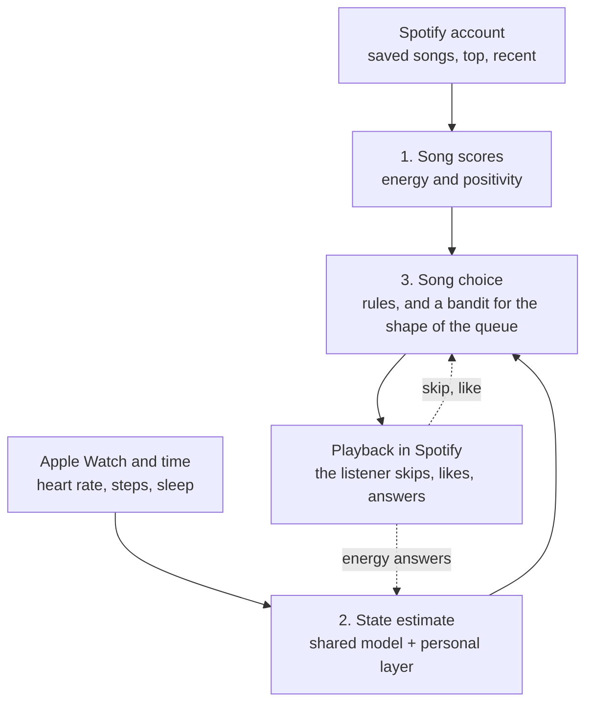
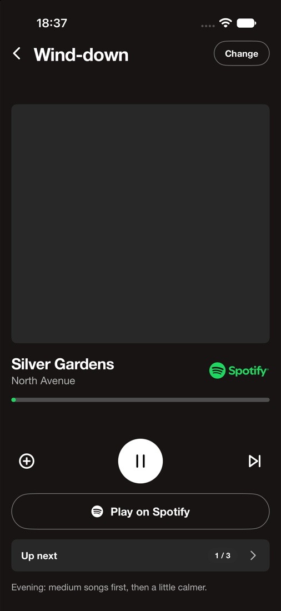
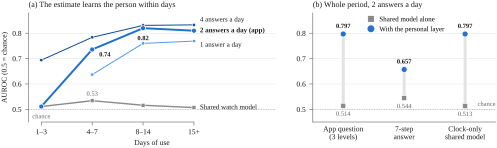

# Context-Aware Music Companion Using Wearable Health Data

*Choosing the right song, from your own Spotify library, for the moment you are in*

**ROYER, Clément** · **VANDEN ABEELE, Cyprien** · **MISKULIN, Lucas** · **MEKIDECHE, Riad**
Dept. Computer Science, Hanyang University, Seoul, S. Korea

Group G02 "FireStarter" — Repository: <https://github.com/SkaosDev/Harmony>

*Submissions C and D, handed in together: architecture design, implementation, use cases. Sections I–IV revise Submissions A and B; Sections V–VII are new. Markdown version of `Submission-C.pdf` (Nov. 26, 2026).*

**Abstract —** Waking up, stress, an afternoon dip and falling asleep are moments in which the right music helps, but nobody wants to search for it then. We built an **iPhone app** that plays a short queue from the user’s own **Spotify** library to fit the moment. Each song gets an energy and a positivity score from the public **MuSe** dataset or, when missing, from a **language model**. A small model trained on **EmoPhone** (282 students in Korea) reads the **Apple Watch** heart rate, steps and sleep and estimates whether the person is more or less activated than usual. Like every published model on these data, it is modest (AUROC 0.57–0.60): a model that only knows other people cannot know *you*. Harmony therefore **learns on the phone**: a one-tap question, “energy right now?”, updates a Bayesian personal layer, and a Thompson-sampling bandit learns from skips and likes how to shape the queue. Replayed in time order on EmoPhone, the personal estimate goes from an AUROC of 0.51 on the first days to 0.82 after a week, at two answers a day. Health data never leave the phone (**Swift**, **SwiftUI**, **HealthKit**, **Core ML**); the model is trained in **Python** with **scikit-learn**. The app is built and tested, and a one-week pilot with the learning switched on is under way.

**Index Terms —** music recommendation, wearable data, on-device learning, personalization, multi-armed bandit, Spotify, Core ML

## Role Assignments

Table I gives the roles. The group has no leader: every member develops, every pull request is reviewed by another member, and decisions are taken together each week. Clément owns the team’s only Mac, which an iPhone app requires, so Clément writes the app in Swift while the other members work on the AI model and the design.

**Table I — Role Assignments**

| **Role** | **Name** | **Task description** |
|---|---|---|
| User | Clément | Uses the app every day with Spotify and an Apple Watch during the pilot; reports bugs. The others use demo mode. |
| Customer | Cyprien | Checks each feature against the needs (Section I-B); reviews every text and screen; approves demos; decides trade-offs. |
| Software developer | Clément | Builds the iPhone app in Swift (Spotify, Apple Health, state estimate, self-learning, queue, screens, tests); repository and documents. |
| Software developer | Cyprien | Builds the AI model: datasets, song-score table, training and evaluation of the state model. |
| Software developers | Lucas, Riad | Work on parts of the AI model and design the screens of the app. |

## I. Introduction

### A. Motivation

Poor sleep and stress are common in Korea: average sleep is 30 minutes below the OECD average, and in one survey only 41% of Koreans were satisfied with their sleep, with stress as the first cause of disturbed sleep [1]. Music can help: a Cochrane review of 13 randomised trials (1,007 adults) found that listening to music improved sleep quality, with moderate certainty [2]. This is evidence about music in general, not about our app, and our pilot does not test it.

Streaming platforms still ignore the listener’s body. Our first users are students and young workers who listen on their phone, wear a smartwatch and have irregular schedules; they want the music they already like, at the right moment, with one tap. The team members belong to this group.

### B. Problem Statement (User Needs)

Given the time of day and the person’s body signals compared with their own usual values, which songs from their own library should be played, and in which order, to help them through the moment? Table II lists the four situations.

**Table II — Target Situations**

| **Situation** | **Typical moment** | **Goal of the music** |
|---|---|---|
| Wake-up | Morning, after sleep | Gently more energetic |
| Stress | Any time of day | Calmer |
| Low energy | Afternoon slump | More energetic |
| Wind-down | Evening, night | Calm and sleepy |

- **N1. No effort:** a tired or stressed person does not want to search for a playlist; one tap should start suitable music.
- **N2. My own music:** songs come mainly from the user’s library, never from generated audio.
- **N3. Fit to my body and my day:** listening history and time of day alone ignore how the person is doing physically.
- **N4. Control of my data:** heart rate and sleep are sensitive; the user must know what is read and be able to delete it.

### C. Existing Solutions

Table III compares the closest products we found, from their public pages; we did not install or test them.

**Table III — Comparison With Related Software**

| **Solution** | **Body signals?** | **User’s own songs?** | **Notes** |
|---|---|---|---|
| Endel [3] | Yes: heart rate, time, weather | No: generates its own sounds | Paid; iOS, Android, Watch |
| Spotify daylist [4] | No: habits and time of day | Yes, through history | Updated several times a day |
| Spotify Prompted Playlists [5] | No: typed prompt and history | Yes, through history | Premium, US and Canada, beta |
| **Our app** | **Yes: heart rate, steps, sleep, time** | **Yes: saved library first** | **iPhone and Spotify first; learns the user on the phone** |

**Endel** reacts to the body but creates its own audio [3]; **Spotify** personalises from history and context, with no wearable [4], [5]. A review of 100 papers finds body signals little studied in music recommenders, partly for lack of datasets [6]. We found no product that combines body signals and the user’s own library, but our search was limited.

### D. Proposed Solution

Fig. 1 shows the app. The person can always choose the situation with one tap and skip any song.

*Fig. 1. System overview. Dashed arrows: what Harmony learns on the phone. Energy answers tune the state estimate (personal layer); skips and likes tune the shape of the queue (bandit).*

**Song scores.** Spotify removed its audio features for new apps in 2024 [7]. We use **MuSe**, 90,408 songs with valence and arousal scores built from Last.fm tags, about 68% with Spotify IDs [8]; for other songs, a large language model (LLM) estimates the two scores from the title and artist.

**State estimate.** A small model says whether the person is more or less activated than usual, never a named emotion. It is trained on **EmoPhone** [9]: three waves (2020–2022) of Korean students who wore a Fitbit and answered short mood questions about seven times a day for four weeks (282 people). Its *arousal* answer, turned into “above or below this person’s own average”, is exactly our output. The inputs are the time of day, the heart rate, the steps and last night’s sleep, each compared with the person’s own average over the last 7 to 14 days; a night without the watch is unknown, never zero sleep. The files stay on team computers (NFR9).

**Learning the person.** A model trained on other people cannot know what is usual for *you*: the best published models on EmoPhone stay near an AUROC of 0.58. Harmony therefore learns on the phone, in two loops (dashed in Fig. 1). If the user agrees, the app asks at most twice a day “energy right now?” (Low, Medium or High), answered with one tap from the notification; each answer updates a *personal layer* that moves the shared estimate toward this person (FR15). Skips, likes and “Did it fit?” feed a *bandit* that learns how this user likes a queue to move toward its goal. Nothing leaves the phone. In simulation, the personal estimate rises from an AUROC of 0.51 on the first days to 0.82 after a week (Section VII-C).

**Song choice.** Rules build a queue of 3 to 5 songs: the first match the current state, the next move step by step toward the goal, following the **iso principle** of music therapy [10]; at most two MuSe songs fill gaps in the library.

**An example.** At 11:30 p.m. the user taps Wind-down. The heart rate is above the person’s usual evening value, so the first song has a medium energy and the next ones become calmer step by step. A skip is recorded for future queues.

**How we test it.** Song scores against MuSe; the shared model on people and a whole wave it has never seen; the self-learning on EmoPhone replayed in time order; and a one-week pilot with one team member (Spotify’s development mode allows five accounts [11]), which measures fit, not health benefits (Section VII).

**Limits.** The app is a wellness demonstrator for five users, not a medical tool; the one-tap situation choice keeps it useful when the estimate is wrong.

### E. Development Plan and Status

Each milestone ends with a demo to the customer; these dates replace those of Submission A.

- **M1, Nov. 15:** Spotify sign-in and import tested with a live account, Apple Health reading, demo mode.
- **M2:** song scores; state model trained on EmoPhone and tested on held-out people and a held-out wave.
- **M3:** queue building, playback, feedback, explanation and data-control screens.
- **M4, Nov. 26 to Dec. 4:** pilot (Nov. 26 to Dec. 2), evaluation, final report and demo.

**Status on Nov. 26, 2026.** M1 to M3 are built and tested; the self-learning was added just before the pilot, which started on Nov. 26. Every pull request is reviewed by another member.

**Changes since Submission A.** EmoPhone replaces UC Irvine and PMData (larger, in-the-moment labels, Korean students); heart-rate variability only feeds the explanation, since EmoPhone lacks it; sleep is estimated for training (Section IV-D); the weather is removed, as locations are anonymised; NFR9 is new.

**Changes since Submission B.** The energy question with the personal layer (FR15) and the queue bandit are new, and each queue plays as a private Spotify playlist (Section V-M).

## II. Requirements

Priorities: Must, Should, Could. Requirements keep their numbers from Submission A and are grouped by module; “(rev.)” marks a change.

### A. Spotify Connection

The app must connect to the user’s Spotify account, read the library and play music.

- **FR1. Sign-in (Must):** connect through Spotify’s secure sign-in (OAuth) and disconnect at any time.
- **FR2. Library import (Must):** download all saved songs (title, artists, cover art), page by page, and store them on the phone.
- **FR9. Playback (Must):** start the queue in Spotify; if this fails, open the songs in the Spotify app.
- **NFR6. Spotify rules:** show cover art unaltered, the Spotify logo and a link to Spotify.

### B. Watch Data and Personal Average

- **FR3. Watch data (Must, rev.):** with permission, read heart rate, heart-rate variability, sleep and steps from Apple Health when the app is opened. Heart rate, steps and sleep feed the model; heart-rate variability feeds the explanation.
- **FR4. Personal average (Must):** compute the person’s usual values over 7 to 14 days and compare recent values with them.
- **NFR4. Missing data and watch not worn:** a night or a period without heart-rate samples is marked as unknown, never as zero sleep or zero steps; if watch data are missing or old, the app still works from the time of day and the library.

### C. Song Scores

- **FR6. Song scores (Must):** give each song an energy and a positivity score from MuSe, or from an LLM estimate when it is not found (Should).

### D. State Estimate

- **FR7. State estimate (Must, rev.):** estimate whether the person is more or less activated than usual with a model trained on EmoPhone.
- **FR15. Energy check-in and personal layer (Should, new):** at most two optional one-tap questions a day (“energy right now?”: Low, Medium, High or Not now); the answers stay on the phone and tune the state estimate to the person; the questions can be switched off at any time.
- **NFR7. Responsible use:** no medical claim, no emotion label shown to the user; the user can always stop or change the music.

### E. Situation and Queue

- **FR5. Situation choice (Must):** four one-tap buttons (Table II), with one suggested from the time, the state and last night’s sleep (Should).
- **FR8. Queue building (Must):** 3 to 5 songs from the library, starting near the current state and moving toward the goal, with at most two matching songs; at most two MuSe songs when the library is not enough (Should).
- **FR11. Explanation (Should):** a short reason, e.g. “short night, morning: calm songs first, then more energy”.
- **NFR3. Speed:** a queue within 2 s of the tap; 2,000 songs imported in under 60 s on Wi-Fi.
- **NFR5. Ease of use:** at most two taps from launch to music.

### F. Feedback, Data Control and Security

- **FR10. Feedback (Must, rev.):** record skips, likes and a “did it fit?” answer, avoid disliked songs, and learn how this user likes a queue to move (bandit).
- **FR13. Data control (Must):** view, export and delete all stored data.
- **NFR1. Privacy:** health data, including the answers to the energy question, stay on the phone; the LLM only receives titles and artists; explicit consent per data source.
- **NFR2. Security:** Spotify tokens in the iOS Keychain; no API key inside the app; HTTPS only.

### G. Demo Mode, Tests and Other Services

- **FR12. Demo mode (Should):** run the app on recorded data, without a live watch.
- **NFR8. Testability:** song scores, state estimate and song choice covered by automated tests on recorded data.
- **FR14. Other services (Could):** support another music service or watch through the same interfaces.

### H. Dataset Terms

- **NFR9. Dataset terms:** EmoPhone data are used on team computers only, never committed to the public repository or shipped in the app.

## III. Development Environment

### A. Choice of Software Development Platform

The app is a native **iOS application**: Apple Watch data are only available on the iPhone through **HealthKit**, and the **Spotify iOS SDK** also runs there. It is built with **Xcode** on Clément’s MacBook, the team’s only Mac. The AI part is written in **Python** on the other members’ Windows computers. The trained model runs on the phone with **Core ML**, and the personal layer and the bandit learn there too, so no server stores health data (NFR1). The only cloud part is a **Cloudflare Worker**, a serverless function that keeps the LLM API key out of the app, accepts only titles and artists, and limits requests per user; its free plan allows 100,000 requests a day [18]. Table IV explains each choice.

**Table IV — Tools and Language Choice**

| **Tool / language** | **Reason** |
|---|---|
| **Swift + SwiftUI** | Apple’s language for HealthKit and Core ML; screens with little code. |
| **HealthKit** | Only way to read Apple Watch data, with per-signal consent. |
| **Spotify Web API + iOS SDK** | Library and lookups; playback in the Spotify app. |
| **SwiftData** | Storage on the phone, no server. |
| **Python, pandas, scikit-learn** | Datasets; logistic regression; tests on people kept apart; self-learning simulation. |
| **coremltools + Core ML** | Runs the model on the phone, offline. |
| **LLM API (Claude Haiku 5.5)** | Scores songs missing from MuSe; fast, low cost. |
| **Cloudflare Workers** | Keeps the LLM key out of the app; free, no server to maintain. |
| **Design canvas (claude.ai)** | Screens drawn once, copied into the repository, reproduced exactly. |
| **GitHub + LaTeX** | Reviews of every pull request; IEEE documents. |

Table V gives the machines and versions; scikit-learn stays at 1.5, the latest that coremltools 8 converts [16].

**Table V — Development Environment**

| **Item** | **Version or resources** |
|---|---|
| Mac (app) | MacBook Air M3, 24 GB RAM; macOS 27.2 |
| Xcode, Swift | Xcode 27.2, Swift 6 language mode |
| App target | iOS 18.0 minimum (SwiftData, current HealthKit APIs) |
| iPhone, Apple Watch | iPhone 16 (iOS 27.2); Apple Watch Series 9 (watchOS 27.2) |
| Computer (data and AI) | Windows 11, 32 GB RAM |
| Python and libraries | Python 3.12; pandas 2.2, scikit-learn 1.5, coremltools 8.3 (model conversion run on the Mac) |
| Spotify iOS SDK | 5.0.1, through Swift Package Manager |
| Cloud | Cloudflare Workers (free plan), deployed with the Wrangler command-line tool |

### B. Cost Estimation

The team uses its own Macs, iPhones and watches, and the development tools are free. Table VI lists the remaining costs. One **Apple Developer Program** membership (US$99 a year [13]) avoids apps that expire after 7 days [14]. **Spotify Premium** is required for playback and for the app owner in development mode [11], [15]. Scoring about 6,000 songs with the **LLM** at the batch price [19] costs under US$1, and four **Claude Pro** subscriptions [17] help with development for two months.

**Table VI — Cost Estimation (prices checked Nov. 4, 2026)**

| **Item** | **Cost** |
|---|---|
| Apple Developer Program (one for the team) | US$99 per year |
| Spotify Premium, per account not yet subscribed | KRW 11,990 / month (KRW 6,600 student) |
| LLM song scores | under US$1 in total |
| Claude Pro for development (4 members, 2 months) | 4 × 2 × US$20 = US$160 |
| Cloudflare Workers (LLM proxy) | free plan |
| Hardware and software tools | already owned or free |

### C. Software in Use

#### 1) Existing Systems / Tools

**Endel** and **Spotify**’s playlists are compared in Section I-C: the first uses the body but not the user’s songs, the second the user’s songs but not the body.

**MuSe** [8] gives valence and arousal for 90,408 songs (CC BY 4.0); we use it directly as song scores.

**EmoPhone and its benchmark** [9] provide the training data and the evaluation method: features from the minutes before each mood answer, tested on people or whole waves held out from training. Its best models reach an AUROC of about 0.58 for arousal on unseen people, with thousands of phone and watch features (0.5 is chance, 1 is perfect).

**WatchAnxiety** [12] predicts anxiety from smartwatch heart rate with 60.4% balanced accuracy, another sign that models shared across people stay modest.

#### 2) Comparison & Gap Analysis

- **Body and own music:** our app combines the body (like Endel) and the user’s songs (like Spotify).
- **Learns the person:** shared models stay near 0.58; our app learns each user on the phone from one-tap answers, skips and likes.
- **Clear goal:** our queue has a goal (calmer or more energetic) and a path toward it, and each queue is explained (FR11).
- **Privacy:** the model and the learning run on the phone; only song titles go to the LLM proxy.

### D. Task Distribution

The work done by each member is given in Table VIII (Section V-N).

## IV. Specifications

Each requirement group is described with its goal, implementation and pseudo-code. This is the plan of Submission B, completed with the self-learning (Requirement 9); Section V describes the code as built.

### A. Requirement 1 – Spotify Connection (FR1, FR2, FR9, NFR6)

**Goal:** Connect the user’s Spotify account, import the library and play a queue.

**Implementation:**

- **App:** OAuth with PKCE, made for apps that cannot keep a secret; tokens in the Keychain (NFR2).
- **Spotify Web API:** the February 2026 changes keep `GET /me/tracks`, `/me/top/tracks`, `/me/player/recently-played` and `GET /tracks/{id}`; the batch `GET /tracks` was removed, and saving a song uses `PUT /me/library` [11].
- **Playback:** the Spotify iOS SDK plays the queue; if it cannot connect, the song opens in the Spotify app.
- **Screen:** cover art unaltered, Spotify logo and link (NFR6).

**Pseudocode:**

    connectSpotify():                  # OAuth with PKCE
      code   = openSpotifyLogin(sha256(verifier))
      tokens = exchange(code, verifier) -> Keychain
    importLibrary():
      url = "/me/tracks?limit=50"
      while url:
        page = GET(url)                  # retry on 429
        db.tracks.upsert(page.items); url = page.next
      add top tracks and recent plays; score new songs

### B. Requirement 2 – Watch Data and Personal Average (FR3, FR4, NFR4)

**Goal:** Read the watch data and compare recent values with the person’s own usual values.

**Implementation:**

- **HealthKit:** on opening, read only the new samples (Apple Health is unreadable while the phone is locked); one consent per signal.
- **Summaries:** raw samples are turned into hourly and nightly summaries, then dropped (NFR1).
- **Personal average:** mean and standard deviation per 3-hour block over the last 14 days, ready after 7 days.
- **Sleep:** HealthKit sleep samples recorded by the Apple Watch only; “in bed” periods set on the iPhone are ignored.
- **Watch worn?** A night counts only if heart-rate samples cover at least 60% of the 21:00–12:00 window; otherwise its sleep is *unknown*, not zero; the same holds for recent steps (NFR4).
- **Missing data:** an unknown value is replaced by the usual value and flagged; without heart rate in the last 30 minutes, the app uses the time of day.

**Pseudocode:**

    onAppOpen():
      for s in [heartRate, hrv, sleep, steps] if consent(s):
        samples = HealthKit.query(s, after=anchor[s])
        db.summaries.update(hourly(samples))
      night = last 21:00-12:00 window
      worn  = share of minutes with heart rate in night
      sleep = watchSleep(night) if worn >= 0.6 else UNKNOWN
      for s, block in signals x 3-hour blocks:
        v = summaries(s, block, last 14 days)
        baseline[s, block] = (mean(v), sd(v)) if days(v) >= 7
                             else NONE

### C. Requirement 3 – Song Scores (FR6)

**Goal:** Give every library song an energy and a positivity score between 0 and 1.

**Implementation:**

- **MuSe table:** shipped with the app, rescaled to 0–1; matched by Spotify ID, then by normalised title and artist.
- **LLM:** missing songs go in batches of 50 (titles and artists only) to the Cloudflare Worker, which calls the LLM; the answer is checked and cached.
- **Check:** offline, the same prompt is run on 2,000 MuSe songs; we report the correlation and the mean error.

**Pseudocode:**

    for t in tracks without score:
      m = muse.byId(t.id) or muse.byTitleArtist(norm(t))
      if m: save(t, m.arousal, m.valence, origin="MuSe")
      else: missing.append(t)
    for batch in chunks(missing, 50):
      scores = POST worker/score {titlesAndArtists(batch)}
      save(batch, valid(scores) or 0.5, origin="LLM")

### D. Requirement 4 – State Estimate (FR7, NFR7)

**Goal:** Estimate, between 0 and 1, whether the person is more or less activated than usual.

**Implementation:**

- **Training data:** for each EmoPhone mood answer, the heart rate and steps of the 15, 30 and 60 minutes before it, last night’s sleep and the time since waking, compared with the person’s own average, plus the hour and the raw heart rate and steps of the last 30 and 60 minutes (17 inputs). The label is 1 when the arousal answer is above the person’s average.
- **Sleep in training:** EmoPhone has no watch-measured sleep, so we estimate it as watches do: the longest period between 21:00 and 12:00 with the watch worn, no steps and a heart rate in the person’s lowest 30%, of at least 2 hours (median 7.3 hours; 34% of nights unknown).
- **Model:** logistic regression, tested with a 5-fold split by participant, kept only if it beats the time-of-day baseline, converted with coremltools.
- **On the phone:** Core ML returns a number, never an emotion label (NFR7).

**Pseudocode:**

    # offline, Python
    x = [z(HR_15), z(HR_30), z(HR_60), z_block(HR_30),
         z(steps_15), z(steps_30), z(steps_60),
         z(sleep), hoursSinceWake, sleepUnknown,
         sin(hour), cos(hour), weekend,
         HR_30, HR_60, logSteps_30, logSteps_60]
    y = arousal > mean arousal of this participant
    for fold in GroupKFold(5, groups=participant):
      fit LogisticRegression; report AUROC, balanced accuracy
    keep if AUROC > time-only baseline -> StateModel.mlmodel
    
    # on the phone
    if no heart rate in last 30 min:
      return prior(hour)             # time-of-day mode
    # 0 = calmer than usual .. 1 = more activated
    return StateModel.predict(x)

**First results.** On the first EmoPhone wave (92 participants, 10,259 answers), our model reaches an AUROC of 0.573 (balanced accuracy 0.542, Fig. 2), close to the best published result on this wave (0.576), which uses thousands of phone and watch features and a slightly different label [9]. Heart rate carries most of the signal; trees do no better, and one heart-rate reading every 5 minutes, as the Apple Watch may give, changes nothing. Steps and sleep help only on the three waves (Section VII-B). Stress is barely predictable, so the user chooses the Stress situation.

*Fig. 2. First results on EmoPhone wave 1, tested on people kept apart (5 folds). Our model in blue; dashed line: best published result.*

### E. Requirement 5 – Situation and Queue (FR5, FR8, FR11, NFR3, NFR5)

**Goal:** Suggest a situation and build a short queue that goes from the current state to the goal.

**Implementation:**

- **Home screen:** four buttons; one is suggested: Wake-up within two hours of waking, Wind-down after 21:00, Low energy between 13:00 and 17:00 when the state is below 0.4.
- **Queue rules:** target energies go from the state to the goal (e.g. 0.2 for Wind-down, 0.7 for Wake-up); each position takes the closest library song, preferring positive songs for Stress and Low energy, avoiding repeated artists and songs of the last 3 days.
- **MuSe fallback:** when no library song is within 0.15 of the target, a MuSe song with a shared artist or genre is checked on Spotify and marked as new (at most two).
- **Explanation:** fixed sentence parts, e.g. “heart rate higher than usual: medium songs first, then calmer”.

**Pseudocode:**

    buildQueue(situation, e0):     # e0 = state estimate
      g = goal[situation]
      n = 5 if |e0 - g| > 0.3 else 3
      m = 2 if n == 5 else 1       # matching songs
      targets = [e0]*m + evenly(e0 -> g, n - m)
      for e in targets:
        c = closest library song to e
            (not recent, not skipped, with penalties)
        if |energy(c) - e| > 0.15 and suggestions < 2:
          c = museSuggestion(e)    # checked on Spotify
        queue.add(c)
      return queue, explain(context, plan)

### F. Requirement 6 – Feedback, Data Control and Security (FR10, FR13, NFR1, NFR2)

**Goal:** Learn from skips and likes, and give the user full control over the stored data.

**Implementation:**

- **Player screen:** skip, like and, after the queue, “did it fit?”. A song skipped twice in a situation is left out of it; a like saves the song to the library; the bandit learns from all three (Requirement 9).
- **Settings screen:** stored data and consents; export as JSON; delete everything after a confirmation.
- **Security:** tokens in the Keychain, HTTPS only; the LLM key stays in the Worker, which receives titles and artists only.

**Pseudocode:**

    on skip (before 30 s): save(skip)
    on like:               save(like); PUT /me/library
    after last song:       ask "Did it fit?"
    deleteAll():
      clear tracks, scores, summaries, queues,
            feedback, consents
      Keychain.delete(tokens); reset HealthKit anchors

### G. Requirement 7 – Demo Mode, Tests and Other Services (FR12, FR14, NFR8)

**Goal:** Run and test the app without a live watch, and keep Spotify and Apple Health replaceable.

**Implementation:**

- **Interfaces:** the core logic only sees two Swift protocols; a new service (Apple Music, Deezer, Health Connect) means one new implementation.
- **Demo mode:** both protocols implemented with synthetic recorded files; no EmoPhone data (NFR9).
- **Tests:** unit tests on these files; Python tests for the Python code.

    protocol MusicProvider {
      func signIn() async throws
      func importLibrary() async throws -> [Track]
      func play(_ q: Queue) async throws
      func save(_ t: Track) async throws
    }
    protocol HealthProvider {
      func requestConsent(_ s: Set<Signal>) async
      func newSamples(_ s: Signal) async -> [Sample]
    }

### H. Requirement 8 – Data Storage and Dataset Terms (NFR1, NFR9)

**Goal:** Store all app data on the phone, and keep the training data out of the public repository.

**Implementation:**

- **Phone:** SwiftData tables below; the MuSe table and the Core ML model are read-only files; tokens in the Keychain.
- **Repository:** `data/` is git-ignored and checked before each submission (NFR9).

**Schema:**

    tracks:    { spotifyId, title, artists[], coverURL,
                 source, addedAt }
    scores:    { spotifyId, energy, positivity, origin }
    hours:     { hourStart, meanHR, sdnnHRV, steps }
    nights:    { date, sleepMinutes, sleepEnd, worn }
    baselines: { signal, block3h, mean, sd, nDays }
    queues:    { id, situation, startEnergy, reason,
                 items[] }
    feedback:  { queueId, spotifyId, event, seconds, time }
    consents:  { source, granted, time }
    Keychain:  { accessToken, refreshToken, expiresAt }

### I. Requirement 9 – Self-Learning: Energy Check-in and Queue Bandit (FR10, FR15, NFR1)

**Goal:** Learn this person on the phone: what is usual for them, and how they like a queue to move.

**Implementation:**

- **Questions:** at most two a day, at a random time in two windows the user can change; “Quick check: energy right now?” is answered from the lock screen or the watch (Low, Medium, High or Not now). Ignoring it changes nothing.
- **Label:** an answer is “above the usual” when it is above the mean of the person’s answers of the last 14 days (at least 5 of them).
- **Personal layer:** one offset *b*, added to the shared model’s log-odds, fitted on the phone as a Bayesian logistic model with a Gaussian prior and forgetting (recent answers weigh more). *b* = 0 without answers.
- **Queue bandit:** three ways of moving toward the goal; Thompson sampling on each queue’s reward, per situation.
- **Storage:** answers kept 30 days on the phone, deleted with everything else (NFR1).

**Pseudocode:**

    on answer a in {Low, Medium, High}:  # -2, 0, +2
      z = log-odds of the shared estimate now
      past = answers of the last 14 days
      label = (a > mean(past)) if count(past) >= 5
      save(a, now, z, label)
    b = argmax  log N(b; 0, 2^2)         # 5 Newton steps
        + sum_i exp(-age_i / 2 days)
                * log P(label_i | z_i + b)
    p = sigmoid(z + b)               # personal estimate
    after a queue:
      r = Yes 1, Nope 0, else 1 - skip share
          (+0.2 per like, at most 1)
      Beta(alpha, beta) of its way += (r, 1 - r)
    next queue: way = argmax of Beta draws,
                or uniform with probability 0.45

### J. System Integration Workflow

**Data flow:**

    [Apple Health] -> Health connector -> hours, baselines
                                              |
    [Spotify] -> Music connector -> tracks -> Song scores
                         (MuSe / LLM via Cloudflare Worker)
                                              |
    user taps a situation -> State model (Core ML)
              energy answers -> + personal layer (b)
                                              |
         Queue rules + bandit (way) + explanation
                                              |
    [Spotify app] <- play / queue  skip, like -> bandit

## V. Architecture Design and Implementation

This section describes the system as built on Nov. 26, 2026, the first day of the pilot; Section V-M lists the differences with the plan.

### A. Overall Architecture

Fig. 3 shows the modules, their main classes and how they use each other. Three choices shape it. First, everything that touches health data runs on the iPhone; the Cloudflare Worker only receives song titles and artists. Second, the core logic never calls Spotify or Apple Health directly: it sees two interfaces, `MusicProvider` and `HealthProvider`, each with a real and a demo version, which enables demo mode, tests and other services (FR12, FR14, NFR8). Third, the shared model is trained once on the team computers and shipped in the app, while the personal layer and the bandit keep learning on the phone.

*Fig. 3. Overall architecture. Each box is a module (number of its subsection below, folder, what it does, main classes); grey boxes are outside services; arrows show which module uses or sends data to which, with what passes along them. The dashed box runs offline on the team computers: it trains the model and builds the MuSe table that are shipped in the app.*

### B. Directory Organization

Table VII lists the folders of the repository, their main files and the module of Fig. 3 they belong to.

**Table VII — Directory Organization**

| **Directory** | **Main files** | **Module** | **Notes** |
|---|---|---|---|
| `app/Harmony/App` | `HarmonyApp`, `RootView`, `TabBar`, `Theme`, `DemoMode` | 1. Screens | start of the app, three tabs, colours and fonts |
| `app/Harmony/Features/` `Onboarding, Home, Player, Library, Settings, Shared` | `OnboardingView`, `HomeView`, `CheckInSheet`, `PlayerView`, `FeedbackView`, `LibraryView`, `SettingsView`, `QuestionsView` | 1. Screens | one folder per part of the design |
| `app/Harmony/Features/Debug` | `DebugView` and seven sections | 1. Screens | Debug builds only: checks and pilot tools |
| `app/Harmony/Core/Queue` | `QueueMaker`, `QueueTargets`, `TrackPicker`, `Explainer`, `QueueBandit` and five more | 2. Queue | rules as pure functions; bandit |
| `app/Harmony/Core/State` | `BaselineCalculator`, `FeatureBuilder`, `StateEstimator`, `CurrentState`, `ModelParams` | 3. State estimate | runs the Core ML model |
| `app/Harmony/Core/Personal` | `CheckInSchedule`, `CheckInRecorder`, `PersonalLayer`, `PersonalRank`, `QueueStart` | 3. State estimate | self-learning: energy question, personal layer (FR15) |
| `app/Harmony/Services/Health`, `app/Harmony/Core/Summaries` | `HealthProvider`, `HealthKitProvider`, `DemoHealthProvider`; `HealthSummaries`, `SummaryStore` | 4. Health connector | Apple HealthKit; hourly and nightly summaries |
| `app/Harmony/Services/Music` (and `Spotify/`) | `MusicProvider`, `SpotifyAuth`, `SpotifyAPI`, `SpotifyRemote`, `DemoMusicProvider` and six more | 5. Music connector | Spotify Web API and iOS SDK |
| `app/Harmony/Core/Scoring`, `app/Harmony/Services` | `MuseCatalog`, `SongKey`, `SongScorer`, `LibraryFigures`; `WorkerClient`, `CheckInNotifications` | 6. Song scores (3. for the notifications) | MuSe first, then the LLM through the Worker |
| `app/Harmony/Core/Models`, `app/Harmony/Core`, `app/Harmony/Core/Pilot` | 10 SwiftData models (`Track`, `QueueRecord`, `CheckIn`…); `DataControl`, `LibrarySync`; `PilotExport` | 7. Local data | export, delete; anonymous pilot file |
| `app/Harmony/Resources` | `StateModel.mlmodel`, `model_params.json`, `muse.sqlite`, `demo/` | 3., 6. | made by the AI pipeline; demo songs and watch data |
| `app/HarmonyTests` | 46 test files, e.g. `QueueTargetsTests`, `FeatureBuilderTests`, `DataControlTests` | all app modules | 281 Swift tests |
| `worker/src`, `worker/test` | `index.ts`, `validate.ts`, `spotify.ts`, `limit.ts`, `llm.ts`, `prompt.ts`; six test files | 8. Cloudflare Worker | TypeScript; 51 tests |
| `ml/`, `ml/tests`, `ml/fixtures`, `ml/prompts` | `build_features.py`, `train.py`, `export_coreml.py`, `muse_build.py`, `personal_layer.py`, `simulate_wp_b0.py`, `make_figures.py` and more | 9. AI pipeline | Python; 89 tests; shared test files |
| `docs/` | `main.tex`, `PROJECT.md`, `TODO.md`, `pilot-protocol.md`, `design/` | – | this report, project plan, screen designs |
| `data/` | not in Git | – | datasets, on team computers only (NFR9) |

Each module is described below with its purpose, what it does, where its code is, its main classes, and what it is built on.

### C. Module 1 – Screens

**Purpose.** Show the app exactly as designed and bring the user to music in two taps (NFR5).

**What it does.** A six-page onboarding (welcome, how it works, Spotify, health data, questions, import), then three tabs: *Home* with the four situations and a “For you” mark (FR5); *Library* with the songs and the origin of their scores; *Settings* with account, consents, questions, my data, about and demo mode. A situation opens the player, with the song, its cover, the Spotify logo and the reason (FR11, NFR6); “Up next” lists the queue, and “Did it fit?” closes it (FR10).

**Where.** `app/Harmony/App`, `app/Harmony/Features`.

**Main classes.** `RootView` (onboarding, loading or tabs), `HomeView`, `PlayerView`, `FeedbackView`, `LibraryView`, `SettingsView`, `CheckInSheet`, `PlayerController` (playback state).

**Built on.** SwiftUI. Lucas and Riad drew every screen in a shared design canvas, copied into `docs/design`; the app takes its colours, fonts, sizes and texts from it. Cyprien reviewed every text: no emotion word, no medical claim (NFR7).

### D. Module 2 – Queue

**Purpose.** Turn a situation and a start point into 3 to 5 songs and a one-line reason, and learn how this user likes a queue to move (FR5, FR8, FR10, FR11).

**What it does.** Each situation has a goal energy: 0.7 for Wake-up and Low energy, 0.3 for Stress, 0.2 for Wind-down. The queue first plays one or two songs that match the current state, then moves in equal steps to the goal (Fig. 4). Each step takes the closest library song, prefers positive songs for Stress and Low energy, avoids repeating an artist, and leaves out songs of the last 72 hours and songs skipped twice in this situation; at most two MuSe songs fill the gaps, after a check on Spotify. The reason is built from fixed sentence parts, e.g. “Evening: medium songs first, then a little calmer.” The bandit of Requirement 9 picks among three ways of moving (gradual, half-way at once, or later) from the rewards of the user’s earlier queues.

**Where.** `app/Harmony/Core/Queue`.

**Main classes.** `SituationSuggester` (“For you”), `QueueTargets` (energy of each step, three ways), `QueueHistory` (songs to avoid), `TrackPicker` (closest song), `SuggestionCheck` (MuSe songs), `Explainer` (reason), `QueueBuilder` and `QueueMaker` (assemble and save), `PlaybackTracker` (skips and finished songs), `QueueBandit` (rewards, Beta posteriors, Thompson draw).

**Built on.** Our own code, written as pure functions and tested first, so each rule has a test.

*Fig. 4. Target energy of each song in two queues. Wake-up starts far from its goal: five songs, two that match the current state, then three steps up. Wind-down starts close to its goal: three songs, one that matches, then two steps down (chart in the PDF).*

| **Queue** | **Song 1** | **Song 2** | **Song 3** | **Song 4** | **Song 5** |
|---|---|---|---|---|---|
| Wake-up from 0.30 (goal 0.7) | 0.30 | 0.30 | 0.43 | 0.57 | 0.70 |
| Wind-down from 0.45 (goal 0.2) | 0.45 | 0.33 | 0.20 | – | – |

### E. Module 3 – State Estimate

**Purpose.** Give a number between 0 and 1 that says how activated the person is compared with their usual, never a named emotion, and learn it for this person (FR4, FR7, FR15, NFR7).

**What it does.** At each tap, it computes the person’s usual values over the last 14 days, builds the 17 inputs of Requirement 4 and runs the shared model; without heart rate in the last 30 minutes it uses the time of day. The shared numbers vary little (90% between 0.32 and 0.58), so without answers the queue starts from the place of the estimate among the person’s own estimates of the last 14 days (calmest 0, most activated 1). It also plans the questions of the day (two by default, four during the pilot), saves each answer with the shared and personal estimates computed just before it, and refits the personal layer of Requirement 9 (Fig. 8). From five labelled answers, the queue starts from the personal estimate, and the reason says so (“your answers show more energy than usual”). One switch (`PersonalMode`) chooses between shadow mode (computed and saved, not used) and active mode; the pilot runs in active mode (Section VII-F).

**Where.** `app/Harmony/Core/State`, `app/Harmony/Core/Personal`, `app/Harmony/Services/CheckInNotifications.swift`.

**Main classes.** `BaselineCalculator` (usual values), `FeatureBuilder` (17 inputs), `StateEstimator` (model or time of day), `ModelParams` (training averages), `PersonalRank` and `QueueStart` (start point, shadow or active), `CheckInSchedule` (questions), `CheckInRecorder` (labels, estimates before each answer), `PersonalLayer` (offset *b*).

**Built on.** Core ML runs the model trained by Module 9; the personal layer is plain Swift. Inputs, probabilities and offsets match Python, which shared test files check (Section VII-A).

### F. Module 4 – Health Connector

**Purpose.** Read the watch data with the user’s consent and keep only summaries (FR3, NFR1, NFR4).

**What it does.** When the app comes to the front, it reads the new heart-rate, variability, steps and sleep samples, and keeps only hourly summaries (mean heart rate, variability, steps) and nightly ones (sleep, wake-up time, watch worn), with the 60% rule of Requirement 2.

**Where.** `app/Harmony/Services/Health`, `app/Harmony/Core/Summaries`.

**Main classes.** `HealthProvider` (interface), `HealthKitProvider`, `DemoHealthProvider`, `HealthSummaries` (summaries, 60% rule), `SummaryStore` (saves them, remembers where reading stopped).

**Built on.** Apple HealthKit, with one consent per signal.

### G. Module 5 – Music Connector

**Purpose.** Everything that talks to Spotify: sign-in, library, playback (FR1, FR2, FR9, NFR2).

**What it does.** Signs the user in on Spotify’s page; imports the saved songs, top tracks and recent plays, merged by Spotify ID; writes each queue into a private playlist, “Harmony”, and starts it in the Spotify app; saves liked songs to the library.

**Where.** `app/Harmony/Services/Music`.

**Main classes.** `MusicProvider` (interface), `SpotifyAuth` and `PKCE` (sign-in without a stored secret), `KeychainTokenStore`, `SpotifyAPI` (Web API, waits when asked to), `SpotifyProvider`, `SpotifyPlaylist`, `SpotifyRemote` (App Remote: plays and reports the current song), `DemoMusicProvider`, `DemoPlayback`.

**Built on.** Spotify Web API and iOS SDK 5.0.1. A playlist plays the whole queue in one call, and opens in Spotify when App Remote cannot connect.

### H. Module 6 – Song Scores

**Purpose.** Give every song an energy and a positivity score between 0 and 1 (FR6).

**What it does.** Looks each new song up in the MuSe table (89,269 songs), by Spotify ID, then by normalised title and first artist (lower case, no accents, no “feat.”); sends the rest to the Worker in batches of 50; uses a neutral 0.5 when the answer is invalid. Each song is scored once, in the background.

**Where.** `app/Harmony/Core/Scoring`, `app/Harmony/Services/WorkerClient.swift`.

**Main classes.** `SongKey` (normalised title and artist), `MuseCatalog`, `SongScorer` (MuSe, Worker, then neutral), `WorkerClient`, `LibraryFigures` (share found in MuSe).

**Built on.** MuSe (CC BY 4.0), turned into an SQLite file by Module 9; the normalisation is the same in Python and Swift, checked on shared cases.

### I. Module 7 – Local Data

**Purpose.** Keep all the app data on the phone, and let the user see, export and delete it (FR13, NFR1).

**What it does.** Stores 10 tables: songs, scores, hourly and nightly summaries, queues and their songs, feedback, consents, energy answers and the log of questions sent. “My data” shows, exports (JSON) and deletes everything. For the pilot, it writes one anonymous file: no song name, health value or date.

**Where.** `app/Harmony/Core/Models`, `app/Harmony/Core`, `app/Harmony/Core/Pilot`.

**Main classes.** `Track`, `SongScore`, `HourSummary`, `NightSummary`, `QueueRecord`, `QueueItem`, `FeedbackEvent`, `Consent`, `CheckIn`, `PromptLog`; `DataControl`, `LibrarySync`, `PilotExport`.

**Built on.** SwiftData, a database inside the app; no server.

### J. Module 8 – Cloudflare Worker

**Purpose.** Keep the LLM API key out of the app (NFR1, NFR2).

**What it does.** One address, `POST /score`: checks the request (at most 50 songs, titles and artists only) and the user’s Spotify token (five allowed accounts), allows 50 requests per user and day, calls the LLM with a fixed prompt and returns the scores.

**Where.** `worker/src`; the prompt is in `ml/prompts`, shared with the offline check.

**Built on.** Cloudflare Workers (TypeScript) and the Anthropic SDK; the key is a Worker secret.

### K. Module 9 – AI Pipeline

**Purpose.** Build and check, on the team computers, everything the app needs from data: the shared model, the MuSe table, the self-learning settings and the shared test files (FR6, FR7, FR15, NFR9).

**What it does.** Computes the 17 inputs of every EmoPhone answer; trains and tests the logistic regression on people kept apart; converts it to Core ML; builds the MuSe table; checks the LLM; replays EmoPhone in time order to choose and test the personal layer (Fig. 7); analyses the pilot file.

**Where.** `ml/` (Table VII).

**Built on.** Python 3.12, pandas, scikit-learn 1.5, coremltools 8; datasets stay outside Git (NFR9).

### L. Implementation Status

On Nov. 26, 2026, the app has 93 Swift files and every requirement is implemented; FR14 is only prepared, through the two interfaces. Both learning loops run on the phone, in active mode since the first evening of the pilot.

### M. Changes From the Specification

- The personal averages are computed in memory, not stored in a `baselines` table.
- The queue plays as a private Spotify playlist, “Harmony”.
- Songs scored by the LLM get no penalty: with any fixed penalty, almost only MuSe songs were chosen.
- A queue starts from the place of the estimate among the person’s own, not from the estimate itself, which varied too little.
- The energy question, the personal layer and the bandit come from a new design of the state model (Nov. 23); each queue records its estimates for the pilot.
- The pilot, planned in shadow mode with two questions a day, runs in active mode with four (amendment of Nov. 26).

### N. Task Distribution

Table VIII gives the work actually done.

**Table VIII — Task Distribution (Work Done)**

| **Member** | **Main tasks** |
|---|---|
| Clément | iPhone app in Swift: data model, Spotify sign-in, import and playback, Apple Health, state estimate, personal layer and bandit on the phone, song scores, queue, screens, energy question, tests; Cloudflare Worker; conversion of the model to Core ML; pilot tools; repository, documents, Apple and Spotify accounts. |
| Cyprien | AI model: comparison of the EmoPhone waves, MuSe table and title normalisation, training and evaluation of the state model (held-out people, held-out wave, UC Irvine). Customer: review of every text of the app. |
| Lucas | AI model: input features in Python (personal averages, heart rate, sleep estimate). App design: screens in the design canvas. |
| Riad | AI model: time-of-day baseline and comparison of inputs. App design: screens in the design canvas (energy question), demo screenshots. |

## VI. Use Cases

Each use case gives its requirements, then its steps. The screenshots (Fig. 5) were taken in demo mode (UC7): synthetic songs, plain colour squares instead of covers, no real health data.

| (a) Welcome (UC1) | (b) Home (UC2) | (c) Player (UC2, UC3) | (d) Up next (UC2) | (e) Library (UC5) |
|---|---|---|---|---|
|  |  |  |  |  |

*Fig. 5. Screens of the app, in demo mode.*

**UC1 – First launch.** *Requirements:* FR1, FR2, FR3, FR6, FR15, NFR1, NFR2. *Actor:* new user with Spotify Premium and an Apple Watch. *Result:* library imported and scored, Home ready.

1. The welcome page (Fig. 5a) and “How it works” present the app.
2. “Connect Spotify” opens Spotify’s sign-in page; tokens go to the Keychain (FR1, NFR2).
3. The health page explains each signal, then the iOS sheet asks for each; the answers are stored as consents (FR3, NFR1).
4. “Two quick questions a day” explains that the answers teach Harmony the user’s usual; “Allow notifications” plans them, “Not now” switches them off until Settings (FR15).
5. The library is imported (2,045 songs in 14.3 s on an iPhone 16) (FR2).
6. Home opens while the songs are scored in the background (FR6).

**UC2 – Music for the moment.** *Requirements:* FR3, FR4, FR5, FR7, FR8, FR9, FR11, NFR3, NFR5, NFR6. *Actor:* user in the evening. *Result:* a short queue plays in Spotify.

1. The app becomes active; new watch samples are summarised (FR3).
2. Home shows the four situations (Fig. 5b); Wind-down is marked “For you” after 21:00 (FR5).
3. The user taps Wind-down, the second tap after launch (NFR5). The state is computed (FR4, FR7); here the start point is medium, 0.45.
4. The start is close to the goal 0.2, so the queue has three songs: one that matches, then two steps down (Fig. 4), with the reason “Evening: medium songs first, then a little calmer.” (FR8, FR11). It is on screen in well under 2 s (NFR3).
5. The player shows the song, its cover, the Spotify logo and the reason (Fig. 5c); “Up next” lists the queue (Fig. 5d) (NFR6). The queue plays in Spotify as the “Harmony” playlist (FR9).

**UC3 – Giving feedback.** *Requirements:* FR10. *Actor:* user listening to a queue. *Result:* the next queues avoid disliked songs, and the bandit learns from the reward.

1. A song left before 30 s counts as a skip; skipped twice in a situation, it is left out of its next queues.
2. “+” saves the song to the Spotify library (like); a song played to its end is recorded as finished.
3. After the last song, “Did it fit?” offers Yes, Nope or Skip. The queue’s reward (Requirement 9) updates the bandit of this situation.

**UC4 – Teaching Harmony one’s usual.** *Requirements:* FR15, NFR1, NFR7. *Actor:* user who allowed the questions. *Result:* the personal layer learns from the answer, on the phone.

1. At a random time in each of the two time windows (Settings → Questions), a notification asks “Quick check: energy right now?”.
2. The user answers Low, Medium or High from the lock screen or the watch, or taps Not now; ignoring it is fine.
3. The answer is stored with the shared and personal estimates of that moment; from the sixth answer on, it is labelled above or below the person’s usual.
4. The offset *b* is refitted on the phone. From five labelled answers, the next queue starts from the personal estimate and its reason may say “your answers show more energy than usual”. “Reset what Harmony learned” erases it all. The question only speaks of energy, never of an emotion (NFR7).

**UC5 – Browsing the library.** *Requirements:* FR2, FR6. *Actor:* any user. *Result:* the user sees the songs and the origin of their scores.

1. The Library tab lists the imported songs with cover, title and artists (Fig. 5e).
2. A badge says “MUSE” or “Estimated” (LLM); the top line gives the share found in MuSe.
3. Search filters by title or artist; refresh imports the library again.

**UC6 – Seeing, exporting and deleting the data.** *Requirements:* FR13, NFR1. *Actor:* any user. *Result:* nothing of the user is left on the phone.

1. Settings → My data counts songs, scores, health summaries, queues, feedback and energy answers (kept 30 days).
2. “Export as JSON” shares the whole store as one file.
3. “Delete everything”, after a confirmation, empties the 10 tables, removes the planned questions, tokens and settings, and restarts the onboarding.

**UC7 – Demo mode.** *Requirements:* FR12, NFR8. *Actor:* team member at a demo, without watch or network. *Result:* the app works on recorded data.

1. Settings → Demo mode (“Recorded data, no watch needed”).
2. The app switches to synthetic songs and watch summaries, in a separate store.
3. Everything works as in UC2 to UC6, with simulated playback; Fig. 5 was taken this way.

## VII. Testing and Evaluation

### A. Automated Tests

On Nov. 26, 2026, all 281 Swift tests (46 files), 89 Python tests and 51 Worker tests pass. They cover, for example, the 60% rule, the queue rules (“Wind-down never ends more energetic”), the bandit, the Worker limits and “Delete everything”. Shared test files written by Python check that the app computes the same inputs, probabilities and personal offset (difference below 10⁻⁶).

### B. Shared State Model

The AUROC is the chance that the model gives a higher number to a moment when the person was above their usual than to one when they were below (0.5 is chance, 1 is perfect). Every test uses people the model has never seen (Fig. 6): cross-validation on waves 1 and 2 (191 participant-waves, 31,301 answers), then one test on wave 3 (106 participants, 21,838 answers), kept apart from every choice. Each group of inputs adds a little. The final model (17 inputs) reaches 0.572 in cross-validation and 0.597 on wave 3 (balanced accuracy 0.545 and 0.556), above the time of day alone (0.534) and at the level of the best published models (about 0.58 [9]); it does not transfer to UC Irvine (24 participants, Samsung watch and Oura ring: 0.496). This is the ceiling of a model that only knows other people.

*Fig. 6. Shared state model on people kept apart: cross-validation on waves 1 and 2 (mean ± s.d. over 5 folds) and one test on the held-out wave 3.*

*Fig. 7. Self-learning, simulated on EmoPhone in time order: each answer is predicted from the earlier answers only. (a) AUROC by days of use, shared model against the personal layer with 1, 2 or 4 answers a day. (b) Whole period at 2 answers a day: with the app’s 3-level question, with a finer 7-step answer, and with a clock-only shared model.*

### C. Self-Learning on the Phone

Since no shared model can know what is usual for *this* person, Harmony learns it on the phone, in two loops, with no server.

**Loop 1, the personal layer.** Each answer to “energy right now?” (Low, Medium, High) is labelled above or below the mean of the person’s answers of the last 14 days. The phone fits one number, an offset *b* added to the log-odds *z* of the watch model: *p* = σ(*z* + *b*). *b* is the maximum a posteriori estimate of a Bayesian logistic model with a Gaussian prior N(0, 2²), in which an answer *a* days old weighs e^(−*a*/2); five Newton steps solve it. With no answer, *b* = 0 and day 1 is the shared model; when answers stop, *b* drifts back to 0 (Fig. 8).

**Loop 2, the queue bandit.** A queue can move toward its goal in three ways: gradually, half-way at once, or after staying longer at the current state. A Thompson-sampling bandit [20] keeps a Beta posterior per way and per situation, updated with each queue’s reward (“Did it fit?”, else the share of songs not skipped, plus 0.2 per like). Each way keeps a probability of at least 0.15, so the bandit never stops exploring.

**Simulation.** We replay EmoPhone in time order, as the app would run: two answers a day are drawn among each person’s real answers (three seeds, 24,166 labelled predictions), and each answer is predicted from the earlier ones only. The forgetting time and the prior were chosen by nested cross-validation on people kept apart. Days 1–3 equal the shared model, since 5 earlier answers are needed for a label. From days 4–7 the personal estimate reaches an AUROC of 0.736, against 0.534 for the shared model; from day 8 on, about 0.82 against 0.52 (Fig. 7a). Over the whole period it goes from 0.514 to 0.797; four answers a day learn faster, one a day slower.

**What these numbers mean.** They come from EmoPhone students, not from our users. The AUROC pools all people: within one person the gain is smaller (0.560 to 0.596 in an earlier simulation). With a finer 7-step answer the label is harder and the gain smaller (0.544 to 0.657). And the same layer on a clock-only model also gives 0.797 (Fig. 7b): the watch makes the first day better than chance, the answers make the estimate personal.

*Fig. 8. The personal layer at work on a made-up user, computed with the code of the app. Top: chance that the person is above their usual, from the watch alone and with the answers. Bottom: the answers.*

The app also has a *shadow mode*, in which the personal estimate is computed and saved but does not change the queue, and the bandit always uses the gradual way. The pilot was planned in this mode; we switched it to active mode on its first evening, so that the app improves during the week (Section VII-F). Both estimates are still saved before each answer, so the comparison of Fig. 7 can be repeated on the pilot’s answers.

### D. Song Scores

On a 2,045-song library, 11.4% are found in MuSe and the rest are scored by the LLM (158 s, in the background). On 2,000 MuSe songs given without their scores, the LLM’s order agrees weakly with MuSe’s (Spearman correlation 0.26–0.28 for energy, 0.32–0.34 for positivity, over three trials), below the threshold set beforehand (0.4), and its mean error is larger than that of a constant neutral score. We still use it, because MuSe itself is weak: 65% of its songs have at most three tags.

### E. App Performance

On the iPhone 16, a queue is on screen 0.28 to 0.37 s after the tap (median of 12 queues, 2,459 songs), far below the 2 s of NFR3 (Fig. 9); a fresh state estimate at each tap adds 0.13–0.15 s. Music starts two taps after launch (NFR5). Without a watch, network or the Spotify app, the app says what happens in one sentence and does not crash (NFR4).

*Fig. 9. Time from the tap to the queue on screen, on the iPhone 16 (bars: median or single measure; whiskers: range).*

### F. Pilot (Under Way)

The pilot follows a protocol written before any data (`docs/pilot-protocol.md`): one participant, Clément, from Nov. 26 to Dec. 2, 2026. A dated amendment, made on the first evening before any analysis, switches both loops to active mode and raises the questions to four a day for the pilot only, so that the app can learn during the week. The phone exports one anonymous file (no song name, health value or date): for each queue, its context, estimate, way of moving, song origins and feedback; for each energy answer, the shared and personal estimates computed just before it. The measures set in advance are kept: the share of quick skips and of “Yes”, with 95% intervals, and whether the personal estimate predicts the answers better than the shared one, for days 1–3, days 4–7 and the week. A before/after comparison is added as exploratory: queues that start from the person’s rank against queues that start from the personal estimate, and the reward of each way of the bandit. With at most about 26 answers, about 21 of them labelled, the queues should start from the personal estimate from about day 3. This shows the learning on a real Apple Watch user; it cannot prove that it helps. Results will be in the final paper.

### G. Limitations

- **Shared model.** An AUROC of 0.57–0.60 matches the best published result but is low in absolute terms, and its estimates vary little (Module 3).
- **Transfer.** The model is trained on Fitbit data of Korean students and does not transfer to UC Irvine.
- **Sleep unknown.** This input has one of the largest weights; it reflects EmoPhone participants not wearing the watch at night, not the body.
- **Self-learning.** Its gain is simulated on EmoPhone and depends on the user answering; the bandit has only a few queues per situation to learn from.
- **Pilot.** One participant for one week, who is also a developer of the app, and no comparison queue: a demonstration, not a proof. Before and after the switch differ in time as well as in learning, so that comparison stays exploratory.

### H. Discussion

More watch inputs or larger models barely change the shared model. What changes the result is learning the person. In simulation, two one-tap answers a day lift the AUROC from 0.51 to about 0.82 after a week, on the phone, without sending anything. The design follows: the watch gives a reasonable first day, and the answers, skips and likes make Harmony personal. The pilot, with both loops switched on, begins to check this on a real user.

## References

[1] Y. Whan-woo, “Sleep market in Korea reaches W3 tril. says report,” *The Korea Times*, Apr. 10, 2024. [Online]. Available: <https://www.koreatimes.co.kr/www/biz/2024/04/126_372435.html>

[2] K. V. Jespersen, V. Pando-Naude, J. Koenig, P. Jennum, and P. Vuust, “Listening to music for insomnia in adults,” *Cochrane Database Syst. Rev.*, no. 8, Art. no. CD010459, 2022, doi: 10.1002/14651858.CD010459.pub3.

[3] Endel, “Endel: personalized soundscapes.” [Online]. Available: <https://endel.io/> (accessed Oct. 20, 2026).

[4] “Spotify launches ever-changing ‘Daylist’ playlist that adapts to users’ moods,” *Music Business Worldwide*, 2023. [Online]. Available: <https://musicbusinessworldwide.com/spotify-launches-ever-changing-daylist-playlist-that-adapts-to-users-moods>

[5] “Spotify brings AI-powered Prompted Playlists to the U.S. and Canada,” *TechCrunch*, Jan. 22, 2026. [Online]. Available: <https://techcrunch.com/2026/01/22/spotify-brings-ai-powered-prompted-playlists-to-the-u-s-and-canada/>

[6] Á. Lozano Murciego, D. M. Jiménez-Bravo, A. Valera Rom\’an, J. F. De Paz Santana, and M. N. Moreno-Garc\’ia, “Context-aware recommender systems in the music domain: a systematic literature review,” *Electronics*, vol. 10, no. 13, Art. no. 1555, 2021.

[7] Spotify for Developers, “Introducing some changes to our Web API,” Nov. 27, 2024. [Online]. Available: <https://developer.spotify.com/blog/2024-11-27-changes-to-the-web-api>

[8] C. Akiki and M. Burghardt, “MuSe: The Musical Sentiment Dataset,” *J. Open Humanit. Data*, vol. 7, 2021, doi: 10.5334/johd.33.

[9] P. Zhang, M. Park, S. Kang *et al.*, “EmoPhone: A multi-wave dataset for in-the-wild mobile and wearable affect sensing,” arXiv:2609.16581, 2026. Data: Harvard Dataverse, doi: 10.7910/DVN/QGRVU8.

[10] K. Starcke, J. Mayr, and R. von Georgi, “Emotion modulation through music after sadness induction—the iso principle in a controlled experimental study,” *Int. J. Environ. Res. Public Health*, vol. 18, no. 23, Art. no. 12486, 2021.

[11] Spotify for Developers, “Web API changes, February 2026” and “February 2026 dev mode changes: migration guide.” [Online]. Available: <https://developer.spotify.com/documentation/web-api/references/changes/february-2026> (accessed Nov. 4, 2026).

[12] M. S. Ahmed *et al.*, “WatchAnxiety: a transfer learning approach for state anxiety prediction from smartwatch data,” arXiv:2509.13725, 2025.

[13] Apple, “Apple Developer Program.” [Online]. Available: <https://developer.apple.com/programs/> (accessed Nov. 4, 2026).

[14] Apple, “Choosing a membership.” [Online]. Available: <https://developer.apple.com/support/compare-memberships> (accessed Nov. 4, 2026).

[15] Spotify, “Premium plans (Korea).” [Online]. Available: <https://www.spotify.com/kr-en/premium> (accessed Nov. 4, 2026).

[16] Apple, “coremltools releases.” [Online]. Available: <https://github.com/apple/coremltools/releases> (accessed Nov. 4, 2026).

[17] Anthropic, “Plans & pricing.” [Online]. Available: <https://claude.com/pricing> (accessed Nov. 4, 2026).

[18] Cloudflare, “Limits,” Cloudflare Workers docs. [Online]. Available: <https://developers.cloudflare.com/workers/platform/limits/> (accessed Nov. 4, 2026).

[19] Anthropic, “Pricing,” Claude Platform Docs. [Online]. Available: <https://platform.claude.com/docs/en/about-claude/pricing> (accessed Nov. 4, 2026).

[20] D. J. Russo, B. Van Roy, A. Kazerouni, I. Osband, and Z. Wen, “A tutorial on Thompson sampling,” *Found. Trends Mach. Learn.*, vol. 11, no. 1, pp. 1–96, 2018.
