> **Course:** ITE 351 - AI & Applications, Hanyang University  
> **Track:** Option B - Prototype service using AIML techniques  
> **Version:** blog in progress, November 26, 2026

---

## Group Members

- **Clément Royer**, Dept. of Computer Science, Hanyang University, clement.royer@edu.devinci.fr
- **Cyprien Vanden Abeele**, Dept. of Computer Science, Hanyang University, cyprien.vanden_abeele@edu.devinci.fr
- **Lucas Miskulin**, Dept. of Computer Science, Hanyang University, lucas.miskulin@edu.ece.fr
- **Riad Mekideche**, Dept. of Computer Science, Hanyang University, riad.mekideche@edu.devinci.fr

**Video presentation (Task 2):** the link will be added here with the final version of the blog.

---

## Table of Contents

- [I. Introduction](#i-introduction)
  - [A. Harmony in One Minute](#a-harmony-in-one-minute)
  - [B. Motivation](#b-motivation)
  - [C. What We Want to See at the End](#c-what-we-want-to-see-at-the-end)
- [II. Datasets](#ii-datasets)
  - [A. EmoPhone: Watch Data and Mood Answers](#a-emophone-watch-data-and-mood-answers)
  - [B. UC Irvine: A Second Test Set](#b-uc-irvine-a-second-test-set)
  - [C. MuSe: Mood Scores for Songs](#c-muse-mood-scores-for-songs)
- [III. Methodology](#iii-methodology)
  - [A. How the Whole System Works](#a-how-the-whole-system-works)
  - [B. The State Model: Reading the Watch](#b-the-state-model-reading-the-watch)
  - [C. From Python to the iPhone With Core ML](#c-from-python-to-the-iphone-with-core-ml)
  - [D. Song Scores: MuSe and a Language Model](#d-song-scores-muse-and-a-language-model)
  - [E. From a Number to a Queue](#e-from-a-number-to-a-queue)
  - [F. Harmony Learns From You](#f-harmony-learns-from-you)
- [IV. Evaluation & Analysis](#iv-evaluation--analysis)
  - [A. How We Test](#a-how-we-test)
  - [B. Results of the State Model](#b-results-of-the-state-model)
  - [C. What the Model Looks At](#c-what-the-model-looks-at)
  - [D. Self-Learning in Simulation](#d-self-learning-in-simulation)
  - [E. How Good Are the Song Scores](#e-how-good-are-the-song-scores)
  - [F. The App on a Real iPhone](#f-the-app-on-a-real-iphone)
  - [G. The Pilot](#g-the-pilot)
- [V. Related Work](#v-related-work)
  - [A. Existing Studies and Products](#a-existing-studies-and-products)
  - [B. Tools and Libraries](#b-tools-and-libraries)
- [VI. Conclusion: Discussion](#vi-conclusion-discussion)
- [References](#references)
- [Progress Log](#progress-log)

---

## I. Introduction

### A. Harmony in One Minute

Harmony is an iPhone app that picks music for the moment you are in. You open it, tap one of four moments (waking up, stress, low energy or winding down), and it starts a short queue of three to five songs from **your own Spotify library**.

The order of the songs is the point. The first song matches how activated you seem right now, and the next ones move step by step toward what the moment needs: calmer before sleep, more energetic in the morning. To guess how activated you seem, Harmony reads your Apple Watch data on the phone (heart rate, steps and last night's sleep), compares them with your usual values and adds the time of day; a small machine-learning model turns all this into one number between 0 and 1. Each song has an energy and a positivity score, so the app can line songs up from where you are to where you want to go.

The player shows one short sentence that explains the queue, for example *"Evening: medium songs first, then a little calmer."* The music plays in Spotify as usual. You can skip a song, like it, and at the end answer "Did it fit?".

**Harmony learns you.** A model trained on other people cannot know what is usual for you, so Harmony learns it on the phone. Twice a day at most, a notification asks *"Quick check: energy right now?"* (Low, Medium or High). Each answer teaches the phone how your energy compares with what the watch suggests, and each skip, like and "Did it fit?" teaches it how you like a queue to move. This learning is the core of the project (Sections III-F and IV-D), and nothing of it leaves the iPhone.

**An example.** It is 11:30 p.m. and you tap *Wind-down*. Your heart rate is higher than your usual evening value, so Harmony does not jump straight to sleepy music: the first two songs have a medium energy, and the next three get calmer one after the other.

<p align="center">
  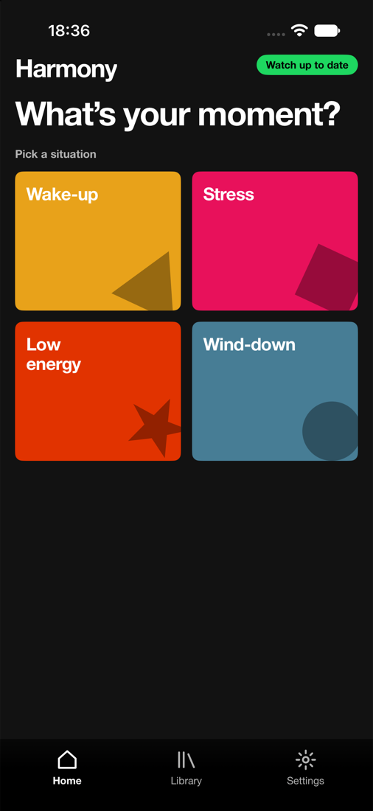
  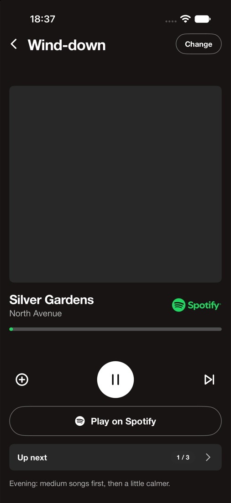
  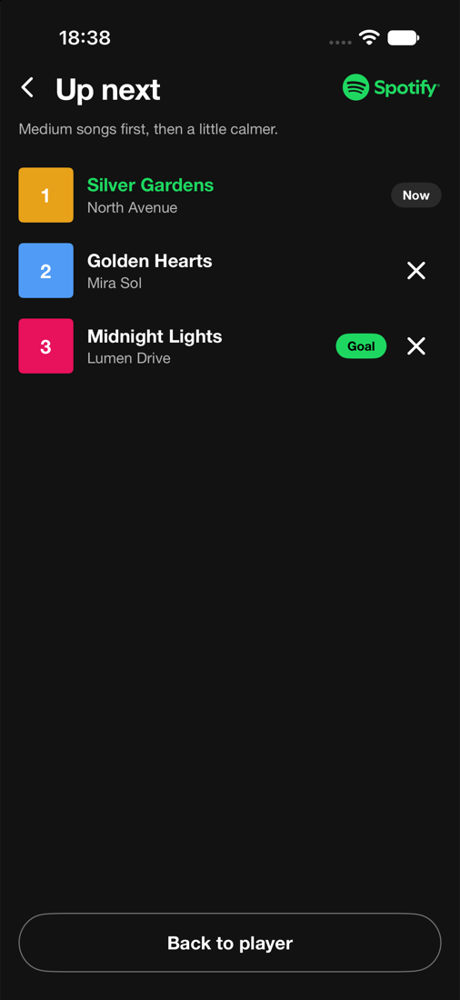
  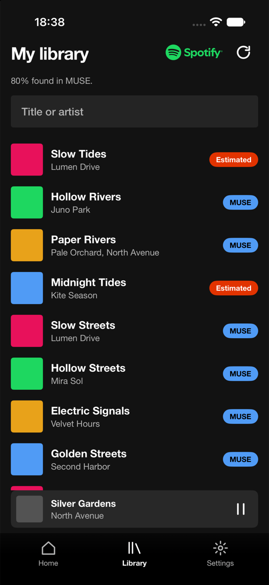
</p>

*Fig. 1. The app on the iOS simulator in demo mode (synthetic songs and watch data, hence no real covers): Home, the player with the reason for the queue, the queue from "Now" to "Goal", and the library with the origin of each song score.*

**Table I - The Four Moments**

| **Moment** | **Typical time** | **What the music should do** | **Energy at the end of the queue** |
|---|---|---|---|
| Wake-up | morning, after sleep | get gently more energetic | about 0.7 |
| Stress | any time | get calmer, with rather positive songs | about 0.3 |
| Low energy | afternoon slump | get more energetic, with rather positive songs | about 0.7 |
| Wind-down | evening, night | get calm, ready for sleep | about 0.2 |

Harmony never tells you "you are stressed" and never names an emotion. It makes no medical claim either: it only offers calmer or more energetic music, and you can always pick the moment yourself and skip any song.

### B. Motivation

Poor sleep and stress are an everyday problem in Korea. A report based on a KB Financial Group study gives an average sleep time of 471 minutes per day, 30 minutes below the OECD average. In a Philips survey cited by the same report, only 41% of Koreans were satisfied with their sleep, and stress was the first cause of disturbed sleep [1].

Music can help. A Cochrane review of 13 randomised trials (1,007 adults) found that listening to music improved sleep quality [2]. This is evidence about music in general: it does not show that our app improves well-being, and we do not claim it.

Yet music apps ignore the body of the listener: a smartwatch measures heart rate, steps and sleep all day, but streaming platforms choose songs from the listening history and the time of day only. Our users, like us, are students and young workers who wear a smartwatch and want the music they already like, at the right moment, with one tap.

For an AI course, the project raises a real question: can a cheap wrist sensor tell how activated a person feels in daily life, well enough to choose music? Published results are modest [3], [9], so we measure honestly how far simple models go, run them on the phone, and let the app learn from each user.

### C. What We Want to See at the End

1. **A state model** that tells, from the watch and the clock, whether a person is more or less activated than usual. It is tested on people it has never seen, and it must beat a model that only knows the time of day.
2. **All the AI on the phone.** The model is converted to Core ML, so heart rate and sleep never leave the iPhone.
3. **Scores for any song**, even songs that no dataset knows, using a large language model (LLM).
4. **An app that learns from each user.** One-tap answers ("energy right now?"), skips and likes adjust the estimate and the way queues are built for that person, on the phone.
5. **A one-week pilot** with real Apple Watch data used every day, to see how the app holds up in daily life and how often its songs are skipped.

**Where we are on November 26.** Points 1 to 4 are built and work from start to finish on an iPhone 16 (Sections III and IV). The pilot started on November 26 with both learning loops switched on and ends on December 2 (Section IV-G); the project ends on December 4.

---

## II. Datasets

Harmony needs two kinds of data: examples of people's watch signals together with how they felt at that moment, to train the state model, and mood scores for songs. No single dataset has both, so we use three.

### A. EmoPhone: Watch Data and Mood Answers

We train the state model on **EmoPhone** [3], a dataset from KAIST shared on Harvard Dataverse. Its authors granted us access to the complete data but not the right to share it, so the files stay on our computers: this blog only shows our method and aggregate results.

EmoPhone has three waves (D-1, D-2 and D-3). In each wave, students of a Korean university used an Android phone and wore a **Fitbit Inspire HR** for about four weeks, and answered short questions about how they felt about seven times a day (Table II).

**Table II - EmoPhone Waves**

| **Wave** | **Period of the answers** | **Participants** | **Mood answers** |
|---|---|---|---|
| D-1 | Feb. 8 - Apr. 2, 2020 | 92 | 10,259 |
| D-2 | Dec. 7, 2020 - Jan. 27, 2021 | 99 | 21,042 |
| D-3 | Nov. 24, 2021 - Jan. 11, 2022 | 106 | 21,838 |
| **Total** | | **297** | **53,139** |

The 297 participant-waves are 282 different people (14 students took part in more than one wave); their codes are not linked across waves, so each wave and code counts as a separate person.

**What we use.** The **heart rate** (about one reading every 5 seconds), the **steps** per minute, and from each mood answer the time, the **arousal** (how calm or activated the person feels, from -3 to +3) and the **stress**. We leave out the phone sensors and questionnaires, because the app only reads the watch and the clock.

**Cleaning.** Timestamps are converted from UTC to Korean time, because the time of day is an input. A night or a period without watch data is **unknown**, never zero sleep or zero steps. People with sensor files but no mood answer are left out.

**The label.** For each answer, the label is 1 when the arousal is above the person's own average, and 0 otherwise. People use the scale differently: one student answers +1 on an ordinary day, another only on a very lively day. A label relative to each person is fairer, and it is exactly what the app needs: "more or less activated than usual".

### B. UC Irvine: A Second Test Set

To see whether the model works outside EmoPhone, we test it on a public dataset from UC Irvine [4]: students in Southern California wore a **Samsung smartwatch** and an **Oura ring** around the 2020 COVID-19 lockdown and rated their mood once a day (24 participant folders, 3,949 answers). There is no arousal question, so we average six items (active, alert, excited, enthusiastic, jittery, nervous) and use the same "above your own average" label. We never train on this dataset: it only tells us whether the model transfers to other people, devices and countries.

### C. MuSe: Mood Scores for Songs

Spotify removed the audio features (energy, valence) from its Web API for new apps in November 2024 [5], so we use **MuSe** [6], a public dataset (CC BY 4.0) in which each song has a valence and an arousal score computed from listeners' Last.fm tags. Version 3, published by the authors on Kaggle, has 90,001 songs, 68.5% of them with a Spotify ID and 92.6% with a genre.

- **Scale.** The raw scores are packed in a small range, so we use percentile ranks. The **energy** comes from the arousal and the **positivity** from the valence: an energy of 0.2 means "calmer than 80% of MuSe songs".
- **Duplicates.** We remove Spotify IDs that point to several songs and keep one row per normalised title and artist: 89,269 songs remain, 59,679 of them with a Spotify ID.
- **Limits.** The scores of a single song are rough: the median song has only 2 emotion tags, and 28.6% of the songs have only one.

MuSe mostly covers older Western songs. On the 2,045 songs of a team member's library, only 233 (11.4%) are in MuSe: 102 found by Spotify ID and 131 by title and first artist. This is why the app needs a second way to score songs (Section III-D).

---

## III. Methodology

### A. How the Whole System Works

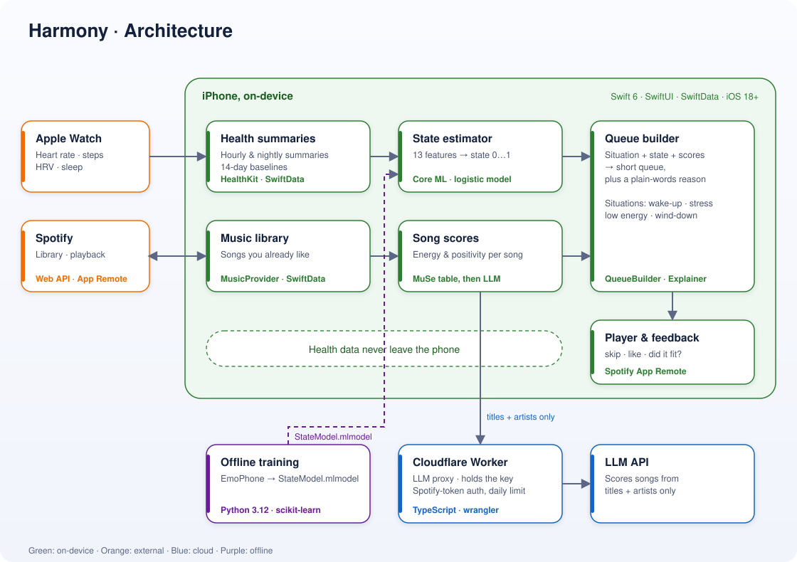

*Fig. 2. Architecture. Green parts run on the iPhone, orange ones are external services, blue is our only cloud part, purple is the offline training on our computers.*

1. **Once, on our computers.** We build the inputs from EmoPhone, train the state model in Python with scikit-learn, evaluate it and convert it to Core ML; the model file ships inside the app.
2. **At the first launch.** The user signs in with Spotify and chooses which Apple Health data the app may read. Harmony imports the saved, top and recent songs and scores each one for energy and positivity, in the background.
3. **Each time the app opens.** It reads the new watch samples from HealthKit and keeps hourly and nightly summaries.
4. **When the user taps a moment.** The phone computes the 17 model inputs from the last 14 days of watch data, runs the model, corrects the estimate with what it has learned about the person, builds the queue and plays it in Spotify.
5. **After each queue and each answer.** Skips, likes and "Did it fit?" update the queue bandit; each answer to "energy right now?" updates the personal layer.

Health data never leave the phone. The only cloud part is a small **Cloudflare Worker** that holds the API key of the language model: it receives song titles and artists, nothing else. Since Spotify allows only five accounts for an app in development mode [13], Harmony is a demonstrator for a few users, not a store app.

The app combines three kinds of AI: a **classical machine-learning model** for the state (Sections III-B and III-C), a **large language model** for song scores (III-D), and **on-device learning** from each user, with a Bayesian personal layer and a reinforcement-learning bandit (III-F). Simple rules connect them (III-E).

### B. The State Model: Reading the Watch

We frame the problem as a **binary classification**: from what the watch and the clock say just before a moment, the model gives the probability that the person feels more activated than usual.

**Inputs.** The model has 17 inputs (Table III). Most compare a signal with the person's **usual** value, because a heart rate of 80 means something different for each of us. The usual value is the mean and spread of the person's own values over the **14 days before** the moment, every 30 minutes from 8 a.m. to midnight when the watch is worn, with at least 7 days of data. An input of +1 then means "one usual spread above your usual" (a z-score).

**Table III - The 17 Inputs of the State Model**

| **Group** | **Input** | **In plain words** |
|---|---|---|
| Time | hour (sine and cosine) | the time of day on a circle, so 11 p.m. is close to 1 a.m. |
| Time | weekend | Saturday or Sunday |
| Heart rate | last 15, 30 and 60 min vs. usual | is your heart rate higher than usual right now? |
| Heart rate | last 30 min vs. usual for this time of day | same question, compared with your usual for this 3-hour block, since heart rate changes during the day |
| Steps | last 15, 30 and 60 min vs. usual | have you moved more than usual? (log of the step count) |
| Raw values | heart rate and steps of the last 30 and 60 min | the same signals without the comparison with your usual |
| Sleep | last night vs. usual | did you sleep more or less than usual? |
| Sleep | hours since waking up | how long you have been awake |
| Sleep | sleep unknown | the watch was not worn last night |

**From Fitbit to Apple Watch.** The Fitbit of EmoPhone measures the heart rate every 5 seconds, the Apple Watch only every few minutes (a median gap of 4.2 to 4.6 minutes on our own watch). So the inputs use **one heart-rate reading every 5 minutes**, which costs almost nothing in accuracy (Section IV-B).

**Unknown is not zero.** A window without watch data is **unknown**, not 0 steps or 0 heart rate. Unknown inputs are replaced by the median of the training data, and the model also knows when last night's sleep is unknown.

**Sleep.** EmoPhone has no measured sleep, so we estimate it as watches do: the longest period between 9 p.m. and noon, of at least 2 hours, with the watch worn, no steps and a heart rate close to the person's lowest values. If the heart rate covers less than 60% of it, the night is unknown. In the app, we read the sleep measured by the Apple Watch.

**The model.** A **logistic regression** (scikit-learn 1.5.2), after median filling and standardisation. The labels are noisy and come from a few hundred people, so a simple model is hard to overfit; its weights can be read directly (Section IV-C); and it is tiny, 17 weights and one intercept.

**What about deep learning?** On waves D-1 and D-2, with the same folds, we compared it with gradient-boosted trees, a tuned logistic regression, interactions between inputs, a small **neural network** (a multi-layer perceptron, also trained on activation, pleasantness and stress at once) and ensembles. None beat the plain logistic regression by more than the variation between folds, as in the GLOBEM benchmark [8], where deep sequence models (1D-CNN, LSTM) did not beat hand-made features on student phone and Fitbit data. With a few hundred training people, a deep model on raw heart-rate series would add cost for a gain smaller than the noise, so we put our effort into learning each person instead (Section III-F).

**Fallback.** A second logistic regression uses the 3 time inputs only. The app uses it when there is no heart rate in the last 30 minutes or when the usual values are not ready yet (the first week). It is also the baseline our model must beat.

**Final training.** After the evaluation of Section IV, the final model is trained once on all three waves (53,139 answers).

### C. From Python to the iPhone With Core ML

Training happens in Python, but the model runs in Swift on the phone.

**Converting the model.** The scikit-learn pipeline (median filling, standardisation, logistic regression) is converted with **coremltools** into `StateModel.mlmodel`: 17 inputs, a missing value passed as NaN, and one probability out. On 100 rows of D-1, half with unknown values, Core ML and scikit-learn give the same probabilities (largest difference about 1e-16). A small JSON file (`model_params.json`) gives the app the order of the inputs and the time-only model.

**Computing the same inputs.** The hard part is the 17 inputs: Swift must compute exactly what Python computed from the raw watch samples, or the model silently receives wrong values. We use **golden tests**: Python generates 10 synthetic watch histories (a weekend, a night, less than 7 days of history, a watch removed for an hour, an unknown night...) with the expected inputs and probability, and a Swift test must find the same values within 1e-6. The personal layer, song-title normalisation and the LLM prompt are checked the same way, with test cases shared by Python, Swift and TypeScript.

**On the phone.** At each tap, the app reads the last 14 days of heart rate and steps from HealthKit in memory, computes the inputs and runs Core ML on the CPU. On an iPhone 16 with real watch data, one estimate takes 0.13 to 0.15 s. Raw samples are never stored and never sent.

### D. Song Scores: MuSe and a Language Model

Every imported song gets an energy and a positivity score between 0 and 1, in this order:

1. **MuSe.** The app looks for the song in a MuSe table shipped inside the app (SQLite), by Spotify ID, then by normalised title and first artist (lower case, no accents, "feat." and "Remastered 2011" removed).
2. **The language model.** Otherwise, the title and artists go to our Cloudflare Worker, which asks **Claude Haiku 5.5** (Anthropic) for the two scores, in batches of 50 songs. The prompt describes each scale, defines 50 as a typical song and gives 48 reference songs from MuSe with their scores; structured output makes the answer always valid JSON.
3. **Neutral.** If the Worker fails or a pair is invalid, the song gets 0.5 and 0.5, and the queue only uses it when nothing better is available.

Each song is scored once and the score is kept on the phone. On the 2,045-song library of Section II-C, the first scoring took 158 s, in the background. The Worker checks the user's Spotify token against an allow-list, keeps the API key secret and limits each user to 50 requests a day. The language model only sees a title and an artist, so its scores are estimates (Section IV-E).

### E. From a Number to a Queue

The queue follows the **iso principle** of music therapy [7]: start with music that matches the current state, then move step by step toward the target. We call `g` the energy goal of the moment (Table I) and `e0` the start point, between 0 and 1. The model's numbers vary little (90% of them between 0.32 and 0.58), so `e0` is the **rank** of the current estimate among the person's own estimates of the last 14 days (calmest 0, most activated 1); once the app has learned the person, `e0` is the personal estimate (Section III-F).

- **Length.** 5 songs when `e0` is far from `g` (more than 0.3 apart), otherwise 3.
- **Targets.** The first one or two songs aim at `e0`; the next targets are spread evenly up to `g`, and the last one is exactly the goal. This is the *gradual* way; the bandit of Section III-F can choose two others. A Wind-down queue never ends more energetic than it starts, and a Wake-up queue never gets calmer.
- **Choosing each song.** For each target, the library song with the closest energy, with penalties: +0.2 for a rather negative song (positivity below 0.5) in Stress or Low energy, +0.3 if the artist is already in the queue. Songs played in the last 3 days, and songs skipped twice in the same moment, are left out.
- **Suggestions.** If no library song is within 0.15 of a target, the app may add at most 2 MuSe songs by an artist or in a genre of the library, after checking with Spotify that the ID is that song.
- **The reason.** The player's sentence is built from fixed parts: the time of day, a short or long night, a heart rate higher or lower than usual, *"your answers show more energy than usual"* once the app has learned it, then the plan. A test goes through every possible sentence and checks that none contains an emotion or a medical word.
- **The suggested moment.** Home may highlight one moment: Wake-up within 2 hours after waking, Wind-down after 9 p.m., Low energy between 1 and 5 p.m. when the state is low. Stress is never suggested, because the model is too weak on stress (Section IV-B).

### F. Harmony Learns From You

The watch model works from the first day without asking anything, but it is weak (Section IV-B), and more inputs or bigger models barely change it. A model trained on other people cannot know what is usual for *this* person, so Harmony learns it on the phone, in two loops, with no server.

**The question.** At most twice a day, at a random time in two windows the user chooses, a notification asks *"Quick check: energy right now?"*: Low, Medium, High or Not now, from the lock screen or the watch. Ignoring it changes nothing (no answer is never read as "low"), and the questions can be turned off. Answers stay 30 days on the phone.

**Loop 1: the personal layer (on-device online learning).** An answer is labelled 1 if it is above the mean of the person's answers of the previous 14 days (at least 5 of them), 0 otherwise. The phone fits one number, an offset `b` added to the log-odds `z` of the watch model:

```
p_personal = sigmoid(z + b)

b = argmax over b of   log N(b; 0, 2^2)
                     + sum_i  w_i * log P(label_i | sigmoid(z_i + b))
w_i = exp(-age_i / 2 days)
```

`b` goes up when the person's answers are more often above their usual than the watch model expects, and down otherwise. It is the maximum a posteriori estimate of a small Bayesian logistic model: the Gaussian prior keeps `b` near 0 while there are few answers, and the weights forget old answers (an answer counts half after about 1.4 days), so the layer follows changes in the person's life and drifts back to the watch model when the answers stop (Fig. 3). With no answer, `b = 0`: day 1 is the shared model. Five Newton steps on a few dozen answers solve it, with no server and no background training. From five labelled answers, the queue starts from the personal estimate and the player says *"your answers show more energy than usual"*.

<p align="center">
  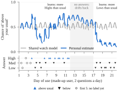
</p>

*Fig. 3. The personal layer at work on a made-up user, computed with the code of the app (an illustration, not real data). Top: chance that the person is above their usual, from the watch alone (grey) and with the answers (blue). Bottom: the answers. Without answers for five days, the estimate drifts back to the watch model.*

**What the user sees.** The About screen shows what Harmony learned over the last 14 days: at each answer, the estimate of the watch alone and the one with the answers, and a sentence from the offset (Fig. 4). The curve appears at the sixth answer, the first that can be compared with the usual.

<p align="center">
  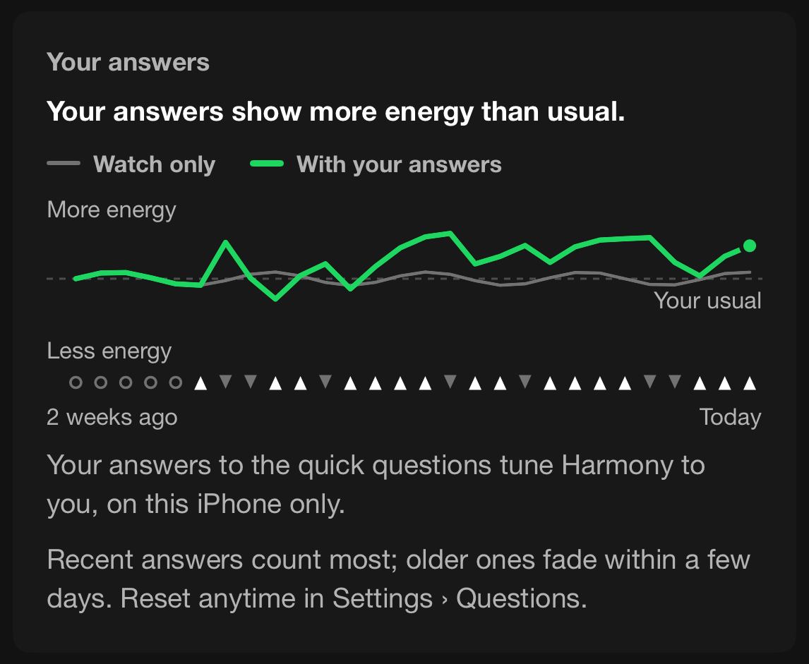
</p>

*Fig. 4. The "Your answers" card of the About screen, in demo mode (made-up answers). Grey: watch only; green: with your answers. Each mark is one answer: up, above the usual; down, below; ring, not compared yet.*

**Loop 2: the queue bandit (reinforcement learning).** A queue can move toward its goal in three ways: *gradual* (Section III-E), *half-way at once* from the second song, or *later*, staying longer at the current state. After each queue, the reward is 1 for "Did it fit?" Yes and 0 for Nope; with no answer, 1 minus the share of songs skipped before 30 s; plus 0.2 per like, at most 1. The app keeps a Beta posterior per moment and way and picks the next way by **Thompson sampling**: one draw from each posterior, the largest wins. With probability 0.45 it picks at random instead, so each way keeps at least a 15% chance. The chosen probability is logged for a fair comparison afterwards, and the state model is never trained on "Did it fit?".

**Shadow and active mode.** One switch decides whether the loops change the queues (active) or are only computed and saved (shadow, always with the gradual way). The pilot was planned in shadow mode with two questions a day; on its first evening we switched it to active mode with four a day, for the pilot only (Section IV-G).

**One more change.** The shared model now has 17 inputs instead of 13: the raw heart rate and steps passed the two criteria we had written down before looking at the results (Section IV-B).

---

## IV. Evaluation & Analysis

### A. How We Test

- **Whole people are kept apart.** The model is always tested on people it has never seen, with a 5-fold `GroupKFold` grouped by participant; a random split would put answers of the same person in training and test and flatter the results.
- **Three levels of test.** Cross-validation on waves D-1 and D-2 (31,301 answers, 191 participant-waves); then **one single test on wave D-3** (21,838 answers, 106 participants), run once after the code was frozen; then one test of the final model on UC Irvine, without retraining.
- **A baseline to beat.** Every result is compared with a model that only knows the time of day.
- **Metrics.** The **AUROC** is the probability that a random "more activated" moment gets a higher score than a random "less activated" one: 0.5 is a coin flip, 1 is perfect. The **balanced accuracy** is the mean of the correct rates on the two classes.
- **The personal layer** is evaluated in time order: each answer is predicted from earlier answers only.

### B. Results of the State Model

<p align="center">
  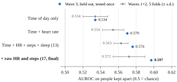
</p>

*Fig. 5. Shared state model on people kept apart: cross-validation on waves D-1 and D-2 (mean ± s.d. over 5 folds) and one test on the held-out wave D-3.*

**Table IV - State Model Evaluation (people never seen in training)**

| **Test and inputs** | **AUROC** | **Balanced accuracy** |
|---|---|---|
| *Waves D-1 + D-2, 5 folds by participant (31,301 answers)* | | |
| Time of day only | 0.534 ± 0.014 | 0.507 |
| Time + heart rate | 0.554 ± 0.012 | 0.513 |
| Time + heart rate + steps + sleep (13 inputs) | 0.563 ± 0.008 | 0.538 |
| **+ raw heart rate and steps (17 inputs, final)** | **0.572 ± 0.018** | **0.545** |
| *Wave D-3, held out and tested once (21,838 answers)* | | |
| Time of day only | 0.534 | 0.511 |
| Time + heart rate | 0.570 | 0.537 |
| Time + heart rate + steps + sleep (13 inputs) | 0.576 | 0.541 |
| **+ raw heart rate and steps (17 inputs, final)** | **0.597** | **0.556** |
| *UC Irvine, final model tested once (3,949 answers)* | 0.496 | |

- **The model beats the time of day**: 0.572 against 0.534 in cross-validation, 0.597 against 0.534 on the wave it never saw. Each group of inputs adds a little, in the same direction in both tests, though each step is of the order of the spread between folds.
- **Heart rate carries most of the signal** (Fig. 6); steps, sleep and the raw values add a little.
- **The level is that of the literature.** The best EmoPhone benchmark models reach about 0.58 for arousal on unseen people, with thousands of phone and watch features [3]; we reach it with 17 inputs that an Apple Watch can provide.
- **It does not transfer.** On UC Irvine (other students, devices and mood scale), the model is at chance (0.496), and a model trained on UC Irvine gets 0.528 on D-3: each model only works on its own data.
- **Stress is barely predictable** (0.54 on D-1), so the app never suggests the Stress moment itself.
- **One heart-rate reading every 5 minutes is enough**: 0.575 against 0.577 with the full Fitbit series on D-1.

<p align="center">
  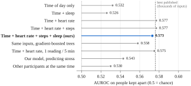
</p>

*Fig. 6. First results on EmoPhone wave D-1, tested on people kept apart (5 folds), which guided the choice of inputs. Our model in blue; dashed line: best published result on this wave (0.576).*

This is the ceiling of a model that only knows other people, and the reason why Harmony learns each person (Sections III-F and IV-D).

### C. What the Model Looks At

For a logistic regression on standardised inputs, the weights are the explanation: a weight of +0.13 means that one standard deviation more on this input raises the log-odds of "more activated than usual" by 0.13. Table V gives the largest weights of the final model.

**Table V - Largest Weights of the Final Model**

| **Input** | **Weight** | **Meaning** |
|---|---|---|
| Heart rate, last 30 min (raw) | +0.21 | a high heart rate points to "more activated" |
| Heart rate, last 30 min vs. usual | -0.19 | strongly linked to the raw value: read the two together |
| Heart rate, last 15 min vs. usual | +0.13 | a heart rate above usual right now points to "more activated" |
| Sleep unknown | +0.11 | see the warning below |
| Steps, last 30 and 60 min (raw) | +0.06, +0.05 | moving points to "more activated" |
| Time of day (sine, cosine) | -0.06, +0.06 | together: highest around 9 p.m., lowest around 9 a.m. |
| Steps, last 15 min vs. usual | +0.06 | moving more than usual points to "more activated" |
| Heart rate vs. usual for this time of day | +0.04 | |
| Heart rate, last 60 min vs. usual | +0.03 | |
| Hours since waking up | +0.03 | |
| Steps, last 30 and 60 min vs. usual | -0.02, -0.03 | linked to the raw steps: read them together |
| Last night's sleep vs. usual | +0.02 | |

All weights are small: the model is cautious, which is expected with noisy labels. The weekend and the raw heart rate of the last 60 minutes weigh almost nothing (0.01 or less). Inputs that measure almost the same thing share their weight, sometimes with opposite signs, so they must be read together. One warning: "sleep unknown" has one of the largest weights, but it mostly reflects a habit of EmoPhone participants, who did not wear the Fitbit on about a third of the nights. It is not a signal from the body, and Apple Watch users who wear their watch at night will rarely have it.

### D. Self-Learning in Simulation

How fast does the personal layer learn? We replayed EmoPhone in time order, as the app would run: two answers a day drawn among each student's real answers (three seeds, 24,166 labelled predictions), each predicted from the earlier ones only. The forgetting time (2 days) and the prior (standard deviation 2) were chosen by nested cross-validation on people kept apart.

<p align="center">
  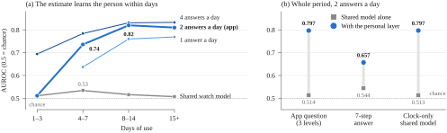
</p>

*Fig. 7. Self-learning, simulated on EmoPhone in time order. (a) AUROC by days of use, shared model against the personal layer with 1, 2 or 4 answers a day. (b) Whole period at 2 answers a day: with the app's 3-level question, with a finer 7-step answer, and with a clock-only shared model.*

**Table VI - AUROC by Days of Use (simulation, pooled over people)**

| **Days of use** | **1-3** | **4-7** | **8-14** | **15+** |
|---|---|---|---|---|
| Shared watch model | 0.511 | 0.534 | 0.516 | 0.507 |
| Personal layer, 1 answer a day | – | 0.637 | 0.760 | 0.769 |
| **Personal layer, 2 answers a day** | **0.511** | **0.736** | **0.820** | **0.810** |
| Personal layer, 4 answers a day | 0.694 | 0.784 | 0.831 | 0.833 |

- **The answers make the difference.** At two answers a day, days 1 to 3 equal the shared model (a label needs 5 earlier answers). Then the personal estimate reaches 0.736 on days 4 to 7 against 0.534, and about 0.82 from day 8 against 0.52; over the whole period, 0.514 to 0.797.
- **What these numbers do not say.** They come from EmoPhone students paid to answer about seven times a day, not from our users. The AUROC pools all people: within one person the gain is smaller (0.560 to 0.596 in an earlier simulation). A finer 7-step answer gives a harder label and a smaller gain (0.544 to 0.657). And the same layer on a clock-only model also reaches 0.797 (Fig. 7b): the watch makes day 1 better than chance, the answers make the estimate personal.
- **When the answers stop, the app falls back to the watch.** In an earlier research simulation, the personal AUROC falls from 0.693 on the day of the last answer to 0.554 a week later, the level of the shared model (0.546, Fig. 8).

<p align="center">
  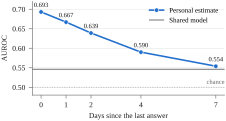
</p>

*Fig. 8. When the answers stop: AUROC of the personal estimate by days since the last answer, against the shared model (research simulation on EmoPhone, earlier model, 7-step answers, two a day).*

### E. How Good Are the Song Scores

To check the language model, we gave it 2,000 MuSe songs with only the title and the artist, and compared its scores with the hidden MuSe scores. Before running the check, we wrote down a rule: for each score, a Spearman correlation of at least 0.4 and a mean error in percentiles below 0.25 (the error of a constant 0.5 is 0.25).

**Table VII - Language Model vs. MuSe on 2,000 Songs**

| **Trial** | **Energy: Spearman / error** | **Positivity: Spearman / error** |
|---|---|---|
| Claude Haiku 4.5, simple prompt | 0.277 / 0.275 | 0.336 / 0.263 |
| Claude Haiku 5.5, prompt describing the scales | 0.279 / 0.273 | 0.324 / 0.266 |
| Claude Haiku 5.5, + 48 reference songs (used in the app) | 0.258 / 0.280 | 0.316 / 0.267 |

No trial passes the rule. Better prompts fixed the scale of the scores (their spread went from 0.13-0.17 to about 0.23, closer to MuSe's 0.29) but not the ranking. Part of the problem is MuSe itself: 65% of its songs have three tags or fewer, and the agreement grows with the number of tags (up to 0.39 for energy and 0.44 for positivity on songs with 4 to 9 tags). The check measures the noise of MuSe as much as the error of the model.

We still use the language model for songs missing from MuSe, because without it almost 90% of a real library would get the neutral score. This is a team decision, not a validated result: the Library tab shows whether each score comes from MuSe or is estimated, and the pilot's skips and "Did it fit?" answers tell whether these queues work.

### F. The App on a Real iPhone

- **Speed.** On an iPhone 16 with a library of 2,459 songs, the queue is on screen 0.28 to 0.37 s after the tap (median 0.34 s over 12 queues; our requirement is under 2 s), plus 0.13 to 0.15 s for the state estimate (Fig. 9).
- **Effort.** Music starts two taps after opening the app.
- **When something is missing.** Without recent heart rate, the queue uses the time of day and Home shows "Watch not synced"; without network or the Spotify app, the app says what happens in one sentence and does not crash.
- **Tests.** On November 26, 281 Swift tests, 89 Python tests and 51 Worker tests pass. Besides the golden tests of Section III-C, they cover the queue rules (for example, a Wind-down queue never ends more energetic than it starts), the bandit, data deletion (all tables are empty afterwards) and the forbidden words in every text.

<p align="center">
  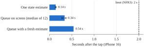
</p>

*Fig. 9. Time from the tap to the queue on screen, on the iPhone 16 (bars: median or single measure; whiskers: range), against our 2 s requirement.*

### G. The Pilot

*Status: under way, November 26 to December 2, 2026; protocol written before any data.*

One participant, a team member, uses the app for one week with an Apple Watch. A dated amendment, made on the first evening before any analysis, switched both learning loops to active mode with four questions a day, for the pilot only, so that the app learns during the week. As set in advance, we measure the share of songs skipped before 30 s and of "Yes" to "Did it fit?" (95% intervals by bootstrap over days); whether the personal estimate predicts the answers better than the shared one (days 1-3, 4-7 and the week); how often MuSe suggestions are used and skipped; and how often watch data are missing. Two comparisons are exploratory: queues that start from the person's rank against queues that start from the personal estimate (expected from about day 3, with at most about 26 answers, 21 of them labelled), and the reward of each way of the bandit.

The phone exports one anonymous file, with no song name, health value or date. With one participant who also built the app and no comparison queue, this is a demonstration on a real user, not a proof.

---

## V. Related Work

### A. Existing Studies and Products

- **EmoPhone benchmark** [3]: gives our training data and our evaluation method (features from the minutes before each answer, labels relative to each person, tests on unseen people). Its best models reach an AUROC of about 0.58 for arousal.
- **UC Irvine dataset** [4]: Samsung watch, Oura ring and daily mood of students around the 2020 lockdown; our second test set.
- **WatchAnxiety** [9]: predicts a yes/no anxiety state from smartwatch heart rate with transfer learning, with 60.4% balanced accuracy.
- **GLOBEM** [8]: a multi-year benchmark of student phone and Fitbit data, where deep models (1D-CNN, LSTM, Transformer) did not beat hand-made features and all methods dropped when tested on another year.
- **Context-aware music recommenders** [10]: a systematic review of 100 papers finds that body signals are little studied, partly because suitable datasets are lacking.
- **Iso principle** [7]: a controlled experiment on mood after a sad film clip supports this principle of music therapy, which our queue follows.
- **Endel** [11]: adapts generated soundscapes to heart rate, time and weather. It uses the body, but not the user's own songs.
- **Spotify daylist** [12]: personalises a playlist from the listening history and the time of day. It plays the user's music, but ignores the body.
- **MuSe** [6]: gives our song scores and the reference songs of the prompt.

### B. Tools and Libraries

All our code is on GitHub: <https://github.com/SkaosDev/Harmony>. The data are never in the repository, only the scripts and aggregate results.

| **Tool** | **What we use it for** |
|---|---|
| Python 3.12, pandas, NumPy | Reading EmoPhone, UC Irvine and MuSe, building the 17 inputs, simulating the personal layer |
| matplotlib | The charts of this blog and of the report |
| scikit-learn 1.5.2 | Logistic regression, gradient-boosted trees, MLP, `GroupKFold`, AUROC and balanced accuracy |
| coremltools 8, Core ML | Converting the model and running it on the iPhone |
| Swift 6, SwiftUI, SwiftData | The iPhone app and its local storage |
| HealthKit | Apple Watch heart rate, steps and sleep (heart-rate variability is only used in the explanation) |
| Spotify Web API, Spotify iOS SDK 5.0.1 | The user's library and playback |
| Cloudflare Workers, Workers KV (TypeScript) | The proxy that holds the LLM key, checks the user and counts requests |
| Anthropic API, Claude Haiku 5.5 | Song scores; the Message Batches API for the offline checks |
| Xcode, XcodeBuildMCP | Building, testing, simulator screenshots |
| GitHub | Code, pull requests reviewed by another member, this blog |
| Claude Code (Anthropic) | AI coding assistant used during development |

---

## VI. Conclusion: Discussion

*This section will be completed after the pilot.*

Can a cheap wrist sensor tell how activated a person feels, well enough to choose music? So far: a little, and hardly more with more effort. With 17 inputs and a logistic regression, the shared model beats the time of day on people and on a wave it has never seen (AUROC 0.57 to 0.60), at the level of the best published models, but it does not transfer to another population, and bigger models do not help.

A model trained on other people has a ceiling: what it misses is the person. So the core of Harmony is learning on the phone, in two loops: a Bayesian personal layer that learns from one-tap answers what is usual for this person, and a Thompson-sampling bandit that learns from skips and likes how they like a queue to move. In simulation, two answers a day lift the AUROC from 0.51 to about 0.82 after a week, without sending anything. Everything runs on the iPhone, and golden tests make sure that Swift computes the same inputs, probabilities and offsets as Python. Song scores come mostly from a language model whose agreement with MuSe is weak; the app shows where each score comes from.

The design follows: the watch gives a reasonable first day, the answers make Harmony personal, and the user can always choose the moment and skip any song. The pilot, with both loops on, checks this on a real Apple Watch user. Open questions for the final version:

- Does the personal layer learn as fast with a real user as in simulation?
- How often are songs skipped, and how often does a queue fit?
- Which way of moving does the bandit favour after a week?

---

## References

[1] Y. Whan-woo, "Sleep market in Korea reaches W3 tril. says report," *The Korea Times*, Apr. 10, 2024. [Online]. Available: <https://www.koreatimes.co.kr/www/biz/2024/04/126_372435.html>

[2] K. V. Jespersen, V. Pando-Naude, J. Koenig, P. Jennum, and P. Vuust, "Listening to music for insomnia in adults," *Cochrane Database Syst. Rev.*, no. 8, Art. no. CD010459, 2022, doi: 10.1002/14651858.CD010459.pub3.

[3] P. Zhang, M. Park, S. Kang *et al.*, "EmoPhone: A multi-wave dataset for in-the-wild mobile and wearable affect sensing," arXiv:2609.16581, 2026. Data: Harvard Dataverse, doi: 10.7910/DVN/QGRVU8.

[4] S. Labbaf *et al.*, "Physiological and emotional assessment of college students using wearable and mobile devices during the 2020 COVID-19 lockdown: An intensive, longitudinal dataset," *Data in Brief*, vol. 54, Art. no. 110228, 2024, doi: 10.1016/j.dib.2024.110228. Data: Dryad, doi: 10.7280/D1WH6T.

[5] Spotify for Developers, "Introducing some changes to our Web API," Nov. 27, 2024. [Online]. Available: <https://developer.spotify.com/blog/2024-11-27-changes-to-the-web-api>

[6] C. Akiki and M. Burghardt, "MuSe: The Musical Sentiment Dataset," *J. Open Humanit. Data*, vol. 7, 2021, doi: 10.5334/johd.33.

[7] K. Starcke, J. Mayr, and R. von Georgi, "Emotion modulation through music after sadness induction—the iso principle in a controlled experimental study," *Int. J. Environ. Res. Public Health*, vol. 18, no. 23, Art. no. 12486, 2021.

[8] X. Xu *et al.*, "GLOBEM dataset: Multi-year datasets for longitudinal human behavior modeling generalization," in *Proc. NeurIPS Datasets and Benchmarks Track*, 2022, arXiv:2211.02733.

[9] M. S. Ahmed *et al.*, "WatchAnxiety: a transfer learning approach for state anxiety prediction from smartwatch data," arXiv:2509.13725, 2025.

[10] Á. Lozano Murciego, D. M. Jiménez-Bravo, A. Valera Román, J. F. De Paz Santana, and M. N. Moreno-García, "Context-aware recommender systems in the music domain: a systematic literature review," *Electronics*, vol. 10, no. 13, Art. no. 1555, 2021.

[11] Endel, "Endel: personalized soundscapes." [Online]. Available: <https://endel.io/> (accessed Oct. 20, 2026).

[12] "Spotify launches ever-changing 'Daylist' playlist that adapts to users' moods," *Music Business Worldwide*, 2023. [Online]. Available: <https://musicbusinessworldwide.com/spotify-launches-ever-changing-daylist-playlist-that-adapts-to-users-moods>

[13] Spotify for Developers, "Web API changes, February 2026" and "February 2026 dev mode changes: migration guide." [Online]. Available: <https://developer.spotify.com/documentation/web-api/references/changes/february-2026> (accessed Nov. 4, 2026).

---

## Progress Log

- **October 29, 2026.** Full access to the EmoPhone dataset granted by its authors.
- **November 10.** The three EmoPhone waves explored; on each wave, time + heart rate beats the time of day.
- **Mid-November.** Spotify sign-in, library import and Apple Watch reading work on a real iPhone; demo mode with synthetic data.
- **November 20.** First model with 13 inputs: cross-validation on D-1 + D-2, single test on D-3; model trained on the three waves and converted to Core ML.
- **November 22.** UC Irvine tested: the EmoPhone model is kept. The model runs in the app, and the golden tests pass on the iPhone.
- **November 23.** Song scores (MuSe, then Claude Haiku 5.5 through the Cloudflare Worker), queue, player and all screens working on an iPhone 16. Personal layer and queue bandit designed and simulated. Pilot protocol written.
- **November 25.** The 17-input model passes the two criteria written down before the results (0.572 in cross-validation, 0.597 on wave D-3) and replaces the 13-input one in the app. The personal layer, the one-tap questions, the queue bandit and the start from the person's rank are built in the app and checked against Python.
- **November 26.** The pilot starts. On its first evening, both learning loops are switched to active mode, with four questions a day for the pilot only. The report gets the charts of this blog.
- **Next.** The pilot until December 2, then the final paper, demo, presentation and video.
